# Lab 07 - Quản lý cửa hàng mini bằng WinForms (SDI, MDI và nhiều Form)

## Thông tin sinh viên

- Họ tên: Huỳnh Thị Hồng Ân
- MSSV: 49.01.103.006
- Lớp: 49.01.SPTIN.A

## Mô tả

Ứng dụng WinForms **ShopManagerMini** quản lý cửa hàng mini gồm nhiều Form: đăng nhập, Form chính dạng MDI Parent, quản lý sản phẩm, quản lý khách hàng và giới thiệu. Dữ liệu được lưu tạm trong bộ nhớ bằng `BindingList<T>`.

## Công nghệ sử dụng

- C# WinForms
- .NET 8 (`net8.0-windows`)
- Visual Studio 2022
- Dữ liệu trong bộ nhớ (`BindingList<T>` + `BindingSource`), chưa dùng SQL Server

## Chức năng

### Danh sách Form

| Form | Vai trò |
|---|---|
| `FrmLogin` | Đăng nhập, trả `DialogResult.OK` khi thành công |
| `FrmMain` | Form chính MDI Parent: MenuStrip, StatusStrip |
| `FrmProduct` | Quản lý sản phẩm (CRUD, DataGridView) |
| `FrmCustomer` | Quản lý khách hàng (CRUD, DataGridView) |
| `FrmAbout` | Giới thiệu ứng dụng và sinh viên |

### Đăng nhập
- Kiểm tra tài khoản mẫu.
- Bỏ trống username hoặc password: hiện cảnh báo.
- Sai tài khoản: hiện thông báo lỗi.
- Đúng: mở `FrmMain`, StatusStrip hiển thị tên người dùng, vai trò và thời gian hiện tại.

### Form chính MDI
- Menu **Hệ thống** (Đăng xuất, Thoát), **Danh mục** (Quản lý sản phẩm, Quản lý khách hàng), **Trợ giúp** (Giới thiệu).
- Form con mở bên trong `FrmMain`; nếu Form cùng loại đang mở thì kích hoạt Form cũ, không mở trùng.
- Đăng xuất: hỏi xác nhận rồi quay lại màn hình đăng nhập.
- Thoát chương trình có hỏi xác nhận.

### Quản lý sản phẩm
- Thêm sản phẩm
- Sửa sản phẩm (chọn một dòng trong danh sách, dữ liệu tự đưa lên ô nhập)
- Xóa sản phẩm (có xác nhận)
- Làm mới danh sách
- Tìm kiếm sản phẩm theo mã, tên hoặc loại
- Không cho thêm trùng mã; không cho đơn giá hoặc số lượng âm; đơn giá và số lượng phải là số hợp lệ

### Quản lý khách hàng
- Thêm, sửa, xóa (có xác nhận), làm mới
- Tìm kiếm theo mã, tên hoặc số điện thoại
- Không cho trùng mã; số điện thoại chỉ gồm chữ số, dài 9 đến 11 ký tự

## Cách chạy

1. Mở file `ShopManagerMini.csproj` bằng Visual Studio 2022 (cần workload **.NET desktop development** và .NET 8 SDK).
2. Build project (`Ctrl + Shift + B`).
3. Chạy project (`F5`).

Hoặc dùng dòng lệnh:

```
dotnet run --project ShopManagerMini.csproj
```

## Cơ sở dữ liệu

Bài lab này **chưa kết nối SQL Server**, nên không có script database và không cần cấu hình connection string. Dữ liệu mẫu được khai báo trong phương thức `SeedSampleData()` của `FrmMain` (3 sản phẩm, 2 khách hàng) và sẽ mất khi tắt chương trình. Danh sách tài khoản mẫu nằm trong `FrmLogin`.

## Tài khoản demo

| Username | Password | Họ tên | Vai trò |
|---|---|---|---|
| admin | 123 | Quản trị viên | Admin |
| user | 123 | Nhân viên bán hàng | User |

## Cấu trúc project

```
ShopManagerMini/
|-- ShopManagerMini.csproj
|-- Program.cs
|-- Models/
|   |-- User.cs
|   |-- Product.cs
|   |-- Customer.cs
|-- Forms/
|   |-- FrmLogin.cs
|   |-- FrmMain.cs
|   |-- FrmProduct.cs
|   |-- FrmCustomer.cs
|   |-- FrmAbout.cs
|-- screenshots/
|-- README.md
|-- TraLoiCauHoi.md
|-- .gitignore
```

(Mỗi Form còn có file `.Designer.cs` đi kèm.)

## Hình ảnh minh họa

### 1. Đăng nhập

#### Màn hình đăng nhập
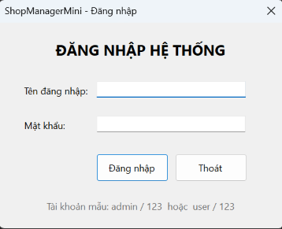

#### Nhập sai tên đăng nhập hoặc mật khẩu
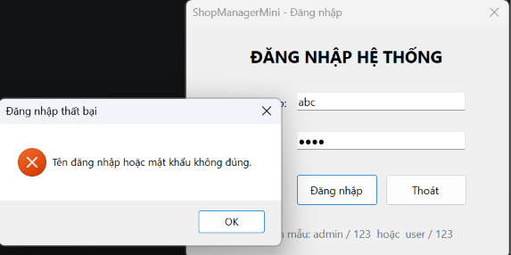

#### Bỏ trống tên đăng nhập hoặc mật khẩu
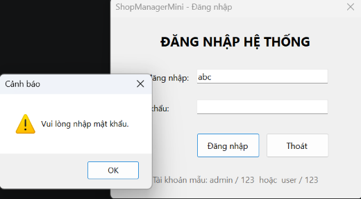

### 2. Form chính (MDI)

Menu **Danh mục** mở các Form con; StatusStrip hiển thị người dùng, vai trò và thời gian.

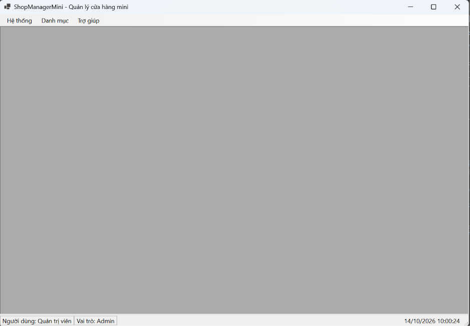

### 3. Quản lý sản phẩm

#### Màn hình quản lý sản phẩm
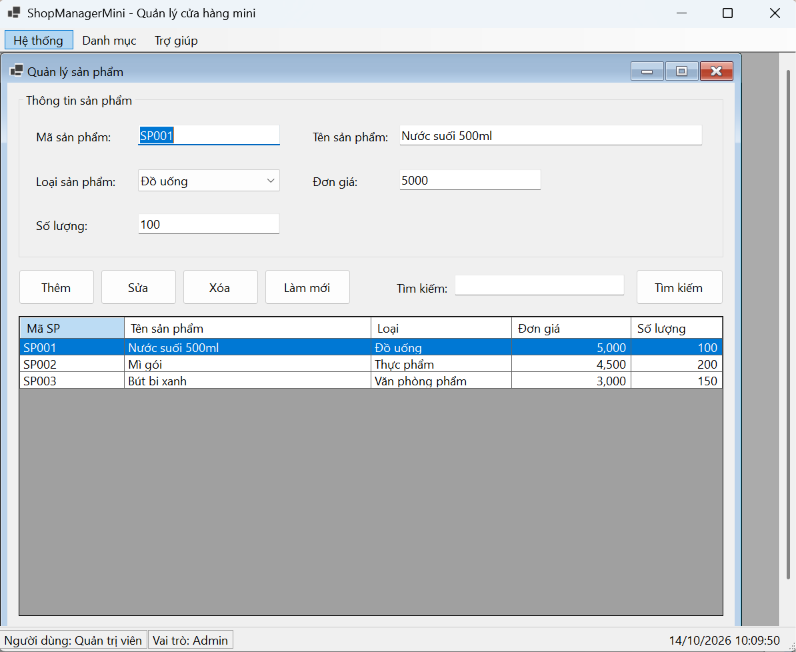

#### Thêm sản phẩm
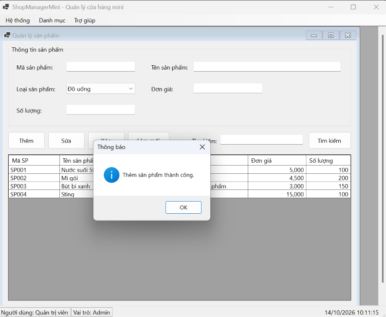

#### Báo lỗi trùng mã sản phẩm
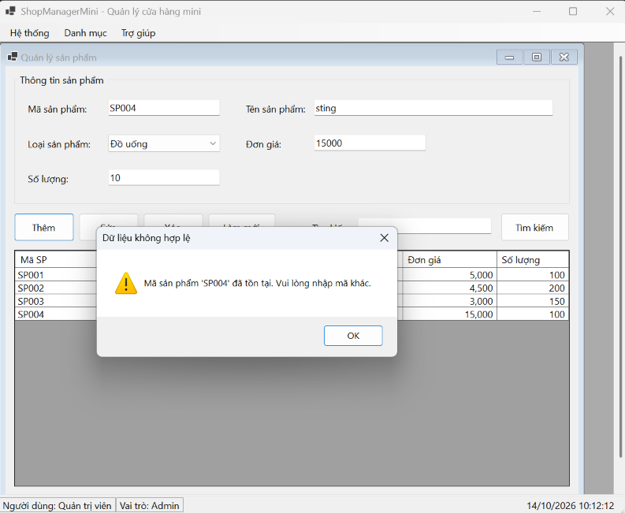

#### Báo lỗi đơn giá âm
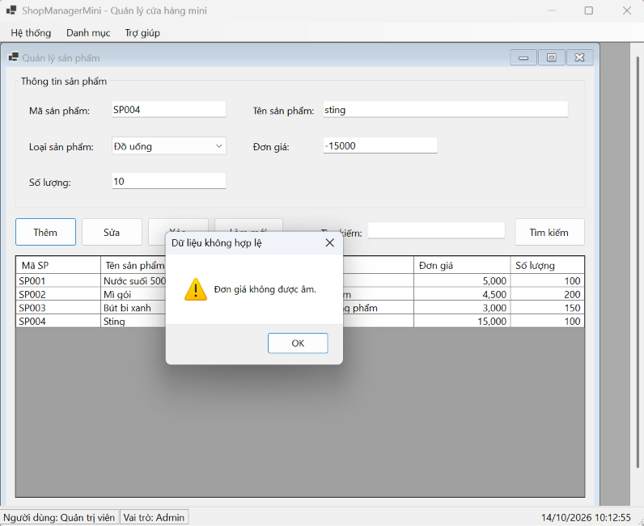

#### Báo lỗi số lượng âm
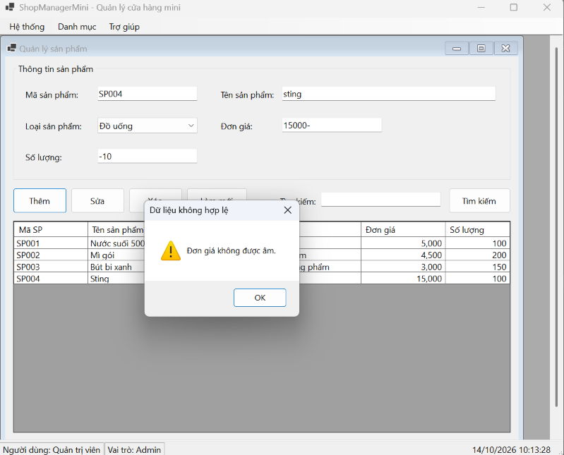

#### Sửa sản phẩm
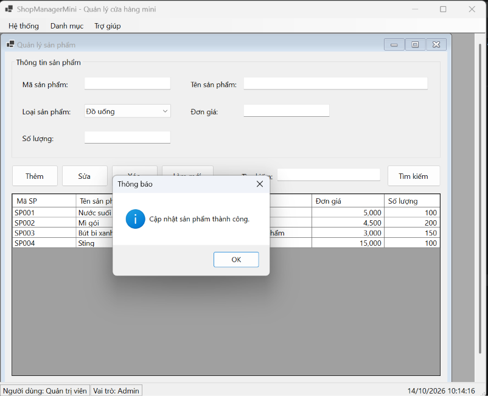

#### Xóa sản phẩm (có xác nhận)
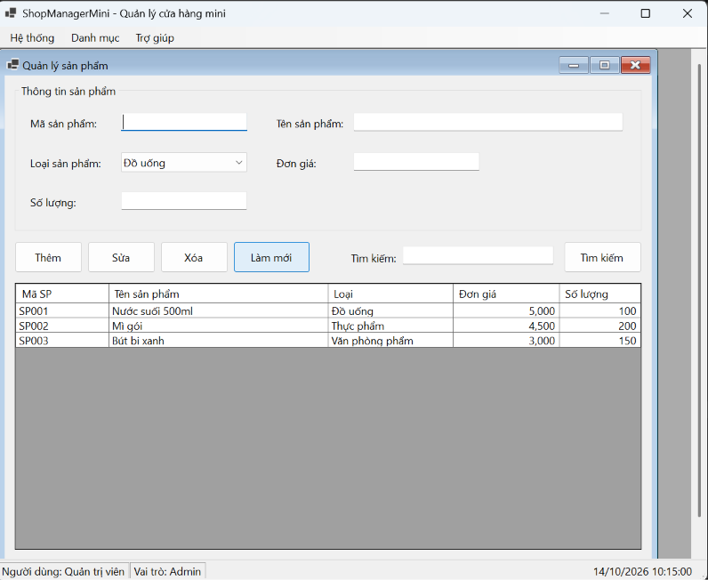

#### Tìm kiếm sản phẩm
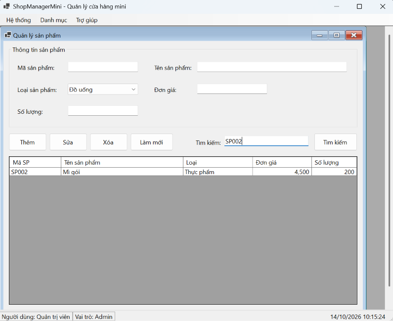

### 4. Quản lý khách hàng

#### Màn hình quản lý khách hàng
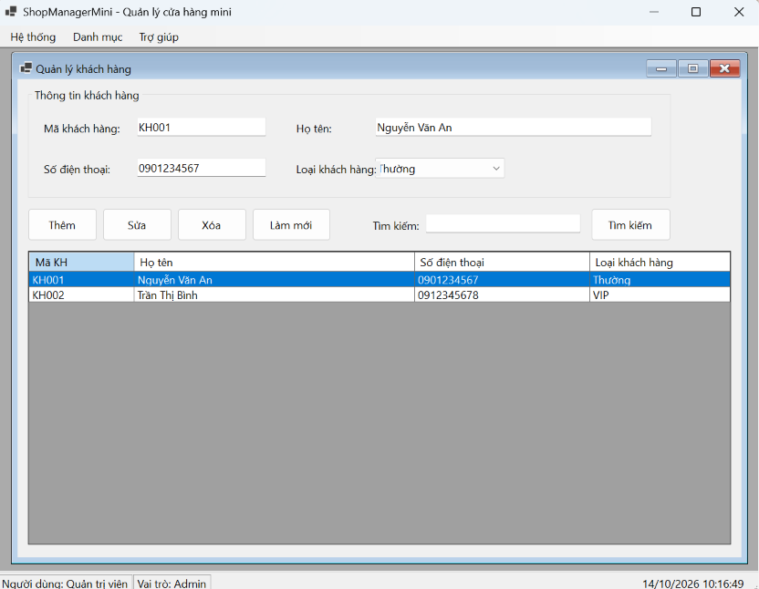

#### Thêm khách hàng
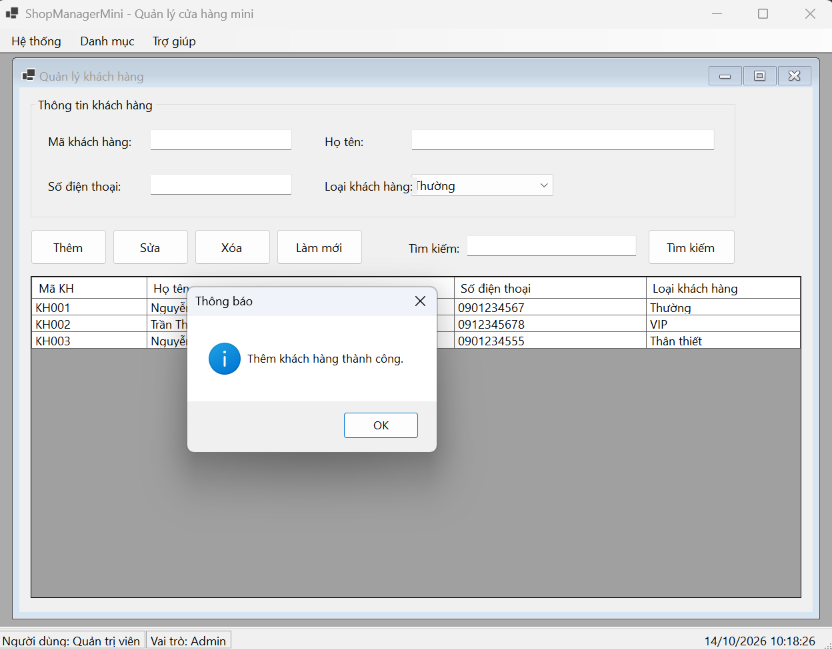

#### Sửa khách hàng
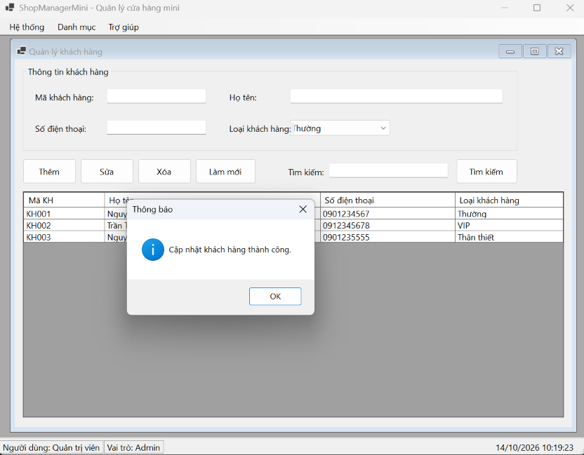

#### Xóa khách hàng (có xác nhận)
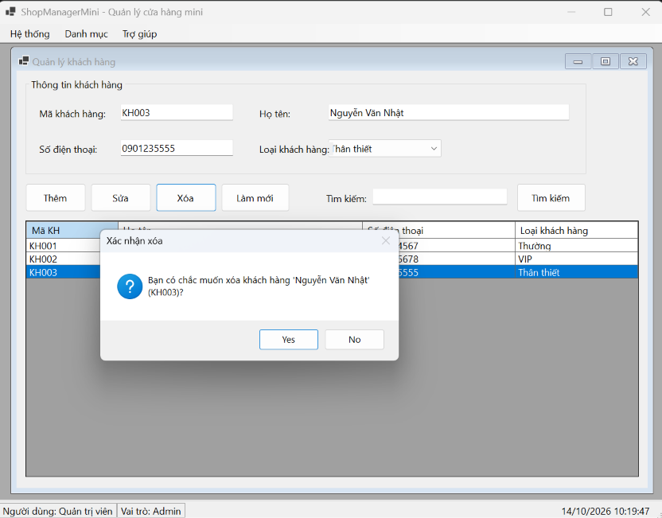

#### Sau khi xóa khách hàng
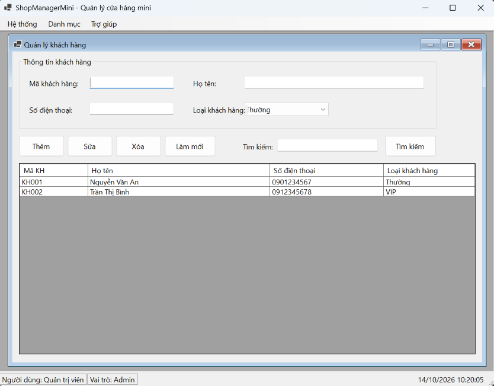

#### Tìm kiếm khách hàng
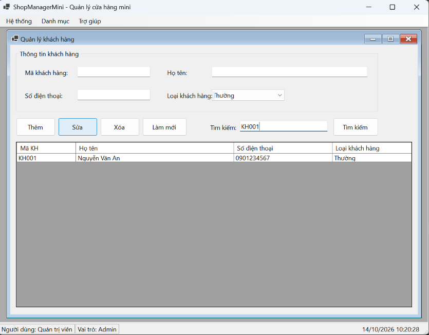

### 5. Giới thiệu

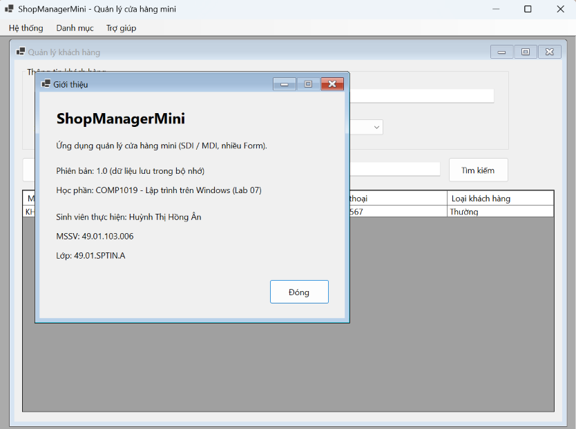

### 6. Xác nhận thoát chương trình

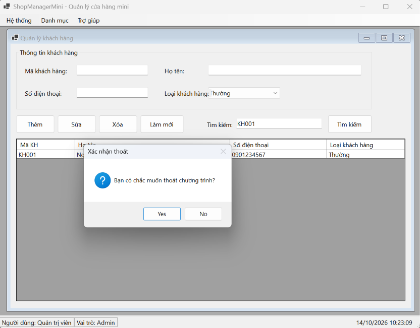

## Câu hỏi nộp kèm

## 1. SDI và MDI khác nhau như thế nào?

| | SDI (Single Document Interface) | MDI (Multiple Document Interface) |
|---|---|---|
| Cách tổ chức | Mỗi cửa sổ là một Form độc lập, không có Form cha chứa các Form khác | Có một Form cha (MDI Parent) chứa nhiều Form con (MDI Child) bên trong |
| Thiết lập | Dùng `Show()` hoặc `ShowDialog()` bình thường | Form cha: `IsMdiContainer = true`; Form con: `MdiParent = formCha` rồi `Show()` |
| Vị trí cửa sổ con | Nằm tự do trên màn hình | Chỉ hiển thị trong vùng làm việc của Form cha |
| Đóng, thu nhỏ | Mỗi Form độc lập | Đóng Form cha thì các Form con cũng đóng; thu nhỏ Form con nằm trong Form cha |
| Ví dụ | Notepad, Calculator | `FrmMain` chứa `FrmProduct`, `FrmCustomer`, `FrmAbout` trong bài lab này |

SDI phù hợp ứng dụng nhỏ, mỗi lần làm một việc. MDI phù hợp ứng dụng quản lý có nhiều màn hình cần mở cùng lúc.

## 2. Vì sao Form đăng nhập nên dùng ShowDialog()?

`ShowDialog()` mở Form dạng **modal**:

- Chương trình **dừng tại dòng gọi** cho đến khi Form đăng nhập đóng, người dùng không thể thao tác với phần khác của ứng dụng khi chưa đăng nhập.
- Trả về **`DialogResult`** (`OK` khi đăng nhập thành công, `Cancel` khi thoát), nên chỉ cần một câu điều kiện để quyết định có mở Form chính hay không.
- Sau khi Form đóng vẫn đọc được dữ liệu từ nó (như `LoggedInUser`) trước khi giải phóng bằng `using`.

Nếu dùng `Show()` (non-modal), code phía sau chạy tiếp ngay, Form chính có thể mở khi chưa đăng nhập và không có cách gọn để biết đăng nhập thành công hay chưa.

Trong `Program.cs`:

```csharp
using (var login = new FrmLogin())
{
    if (login.ShowDialog() != DialogResult.OK)
    {
        return; // bấm Thoát hoặc đóng form đăng nhập
    }
    currentUser = login.LoggedInUser;
}

var main = new FrmMain(currentUser);
Application.Run(main);
```

## 3. Dữ liệu user được truyền từ FrmLogin sang FrmMain bằng cách nào?

Truyền qua hai bước:

1. `FrmLogin` kiểm tra tài khoản trong danh sách tài khoản mẫu; nếu đúng thì lưu user vào property **`LoggedInUser`** rồi đặt `DialogResult.OK`.
2. `Program.cs` đọc `login.LoggedInUser` và truyền vào **constructor** `new FrmMain(currentUser)`. `FrmMain` lưu vào biến `_user` và hiển thị tên, vai trò lên StatusStrip (`lblUser`, `lblRole`).

```csharp
// FrmLogin
public User LoggedInUser { get; private set; }
...
LoggedInUser = found;
DialogResult = DialogResult.OK;

// FrmMain
public FrmMain(User user)
{
    InitializeComponent();
    _user = user;
    lblUser.Text = "Người dùng: " + _user.FullName;
    lblRole.Text = "Vai trò: " + _user.Role;
}
```

## 4. Nếu người dùng bấm menu sản phẩm nhiều lần, chương trình xử lý như thế nào để không mở trùng Form?

Hàm `OpenChild<T>()` duyệt qua danh sách `MdiChildren` của Form cha:

- Nếu đã có Form cùng kiểu (`child is T`): khôi phục nếu đang thu nhỏ, gọi `Activate()` để đưa lên trước rồi `return`, không tạo Form mới.
- Nếu chưa có: tạo Form mới, gán `MdiParent = this` và `Show()`.

```csharp
private void OpenChild<T>(Func<T> factory) where T : Form
{
    foreach (Form child in MdiChildren)
    {
        if (child is T)
        {
            if (child.WindowState == FormWindowState.Minimized)
                child.WindowState = FormWindowState.Normal;
            child.Activate();
            return;
        }
    }

    T form = factory();
    form.MdiParent = this;
    form.Show();
}

private void mnuProduct_Click(object sender, EventArgs e)
{
    OpenChild(() => new FrmProduct(_products));
}
```

Khi đóng Form con rồi bấm menu lần nữa thì Form mới được tạo lại, vì lúc đó nó không còn trong `MdiChildren`. Danh sách sản phẩm được giữ ở `FrmMain` (`_products`) nên dữ liệu không mất khi đóng rồi mở lại Form.

## 5. Khi nào nên dùng constructor, khi nào nên dùng property để truyền dữ liệu giữa các Form?

| | Constructor | Property |
|---|---|---|
| Dùng khi | Dữ liệu **bắt buộc** để Form hoạt động và đã biết ngay lúc tạo Form | Dữ liệu **tùy chọn**, hoặc gán/đọc **sau khi** Form đã tạo, hoặc cần **lấy kết quả trả về** |
| Ưu điểm | Không thể quên truyền dữ liệu; Form luôn ở trạng thái hợp lệ | Linh hoạt, gán từng phần, đọc lại kết quả sau `ShowDialog()` |
| Lưu ý | Form có constructor tham số thì phải tạo bằng `new FrmX(...)` (vì vậy `OpenChild` nhận `Func<T>`); Designer cần constructor không tham số để hiển thị | Có thể quên gán nên cần kiểm tra giá trị |
| Trong bài lab | `FrmMain(User user)`, `FrmProduct(BindingList<Product>)`, `FrmCustomer(BindingList<Customer>)`: cần dữ liệu ngay từ đầu | `FrmLogin.LoggedInUser`: lấy kết quả sau khi đăng nhập xong |
