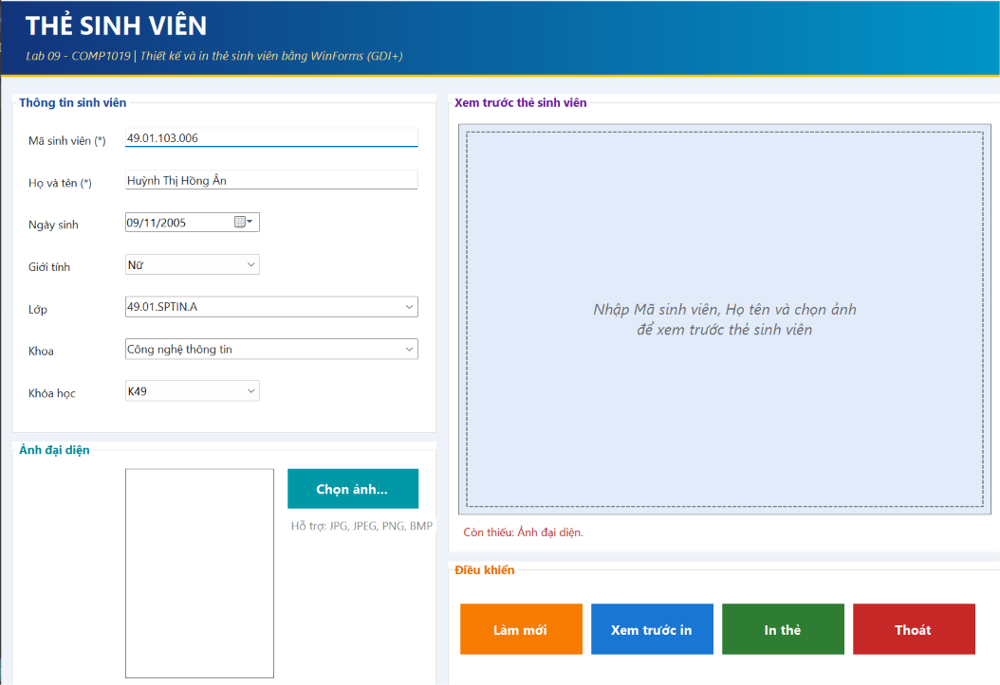
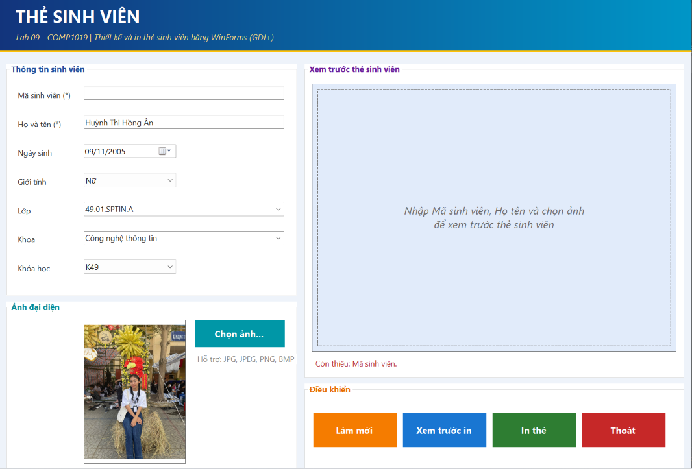
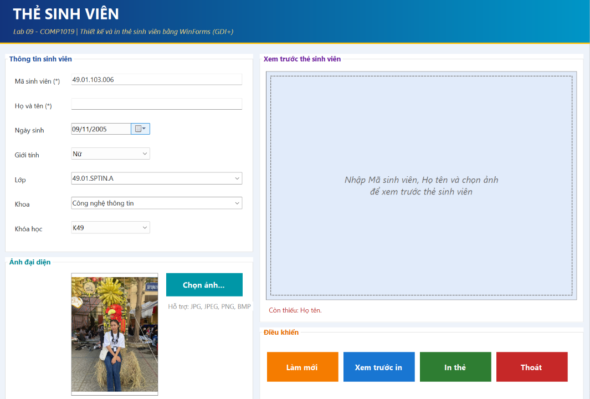
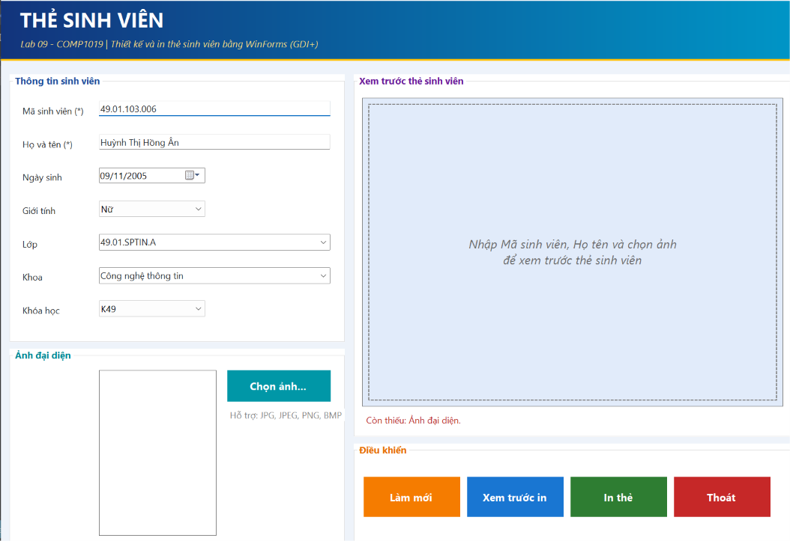
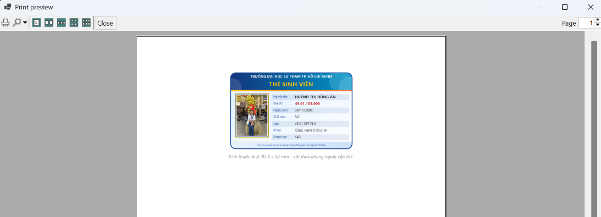
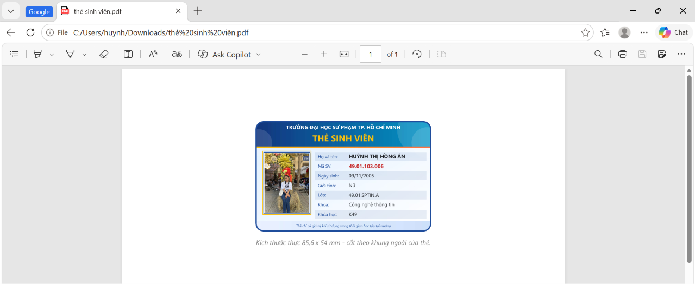
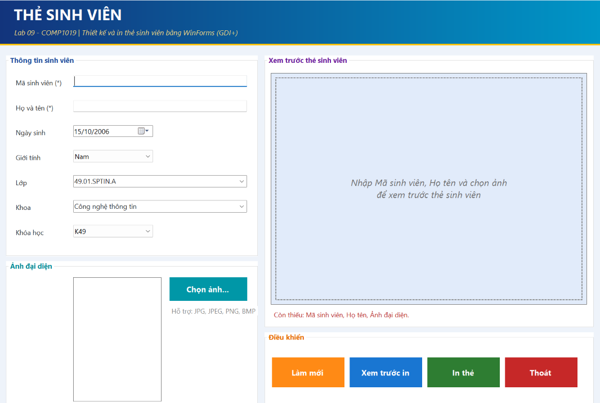

# Lab 09 – Thiết kế và in thẻ sinh viên bằng WinForms

## Thông tin sinh viên

- Họ tên: Huỳnh Thị Hồng Ân
- MSSV: 49.01.103.006
- Lớp: 49.01.SPTIN.A
- Môn học: COMP1019 – Lập trình trên Windows (Buổi 9 – Lab 09)
- Form chính: `FrmStudentCard`

## Mô tả

Ứng dụng Windows Forms cho phép **nhập thông tin sinh viên**, **chọn ảnh đại diện**, **xem trước thẻ sinh viên theo thời gian thực** và **in thẻ** qua `PrintDocument`.

Thẻ được vẽ bằng **GDI+** trên `Panel`. Cùng một hàm vẽ (`CardRenderer.Draw`) được dùng lại cho `PrintDocument`, nên **bản in luôn giống bản xem trước**.

Ứng dụng **không dùng cơ sở dữ liệu**: dữ liệu nhập trực tiếp trên Form và chỉ tồn tại trong lúc chương trình chạy.

Giao diện được thiết kế nhiều màu: banner gradient, mỗi nhóm điều khiển một màu, nút bấm phẳng mỗi nút một màu, thẻ sinh viên có nền gradient, dải tiêu đề màu và khung ảnh viền vàng.

## Công nghệ sử dụng

- C# 12 – Windows Forms, .NET 8 (`net8.0-windows`)
- Visual Studio 2022 (workload *.NET desktop development*)
- GDI+: `Graphics`, `GraphicsPath`, `LinearGradientBrush`, `Pen`, `StringFormat`, sự kiện `Paint` của `Panel`
- `PictureBox`, `OpenFileDialog`
- `PrintDocument`, `PrintPreviewDialog`, `PrintDialog`
- `ErrorProvider`, `MessageBox`
- `record` (C# 9+) để lưu dữ liệu thẻ

## Cấu trúc thư mục

```
Lab09_StudentCard/
├── Lab09_StudentCard.csproj
├── Program.cs                       # điểm vào chương trình
├── FrmStudentCard.cs                # logic form: chọn ảnh, preview, validation, in, làm mới
├── FrmStudentCard.Designer.cs       # khai báo và bố cục control, gắn sự kiện
├── Models/
│   └── StudentInfo.cs               # record dữ liệu một thẻ sinh viên
├── Helpers/
│   ├── CardRenderer.cs              # vẽ thẻ bằng GDI+ (dùng chung cho Preview và In)
│   └── ImageHelper.cs               # nạp ảnh không khóa file, xoay theo EXIF, tính khung giữ tỉ lệ
├── CustomControls/
│   └── DoubleBufferedPanel.cs       # Panel bật DoubleBuffered để vẽ không nháy
├── screenshots/                     # ảnh chụp màn hình nộp bài
├── TESTCASES.md                     # bộ test case (bản riêng)
└── README.md
```

| File / lớp | Vai trò |
|---|---|
| `FrmStudentCard` | Xử lý sự kiện, kiểm tra dữ liệu, điều khiển preview và in |
| `StudentInfo` | Gói 7 thông tin của thẻ; bất biến nên dùng làm "bản chụp" khi in |
| `CardRenderer` | Toàn bộ code GDI+ vẽ thẻ; không phụ thuộc vào Form |
| `ImageHelper` | Nạp ảnh an toàn và tính toán để ảnh không bị méo |
| `DoubleBufferedPanel` | Chống nháy hình khi Panel vẽ lại liên tục |

## Thiết kế giao diện

Form cố định kích thước (`FormBorderStyle = FixedSingle`), chia **hai vùng**: bên trái nhập liệu, bên phải xem trước thẻ.

```
┌──────────────────────────────────────────────────────────────┐
│  THẺ SINH VIÊN  (banner gradient xanh đậm → xanh ngọc)       │
├──────────────────────────┬───────────────────────────────────┤
│ Thông tin sinh viên      │ Xem trước thẻ sinh viên           │
│  Mã SV / Họ tên          │  ┌─────────────────────────────┐  │
│  Ngày sinh / Giới tính   │  │   Panel pnlPreview (GDI+)   │  │
│  Lớp / Khoa / Khóa học   │  └─────────────────────────────┘  │
├──────────────────────────┤  dòng trạng thái "Còn thiếu: …"   │
│ Ảnh đại diện             ├───────────────────────────────────┤
│  PictureBox + Chọn ảnh   │ Điều khiển: 4 nút                 │
└──────────────────────────┴───────────────────────────────────┘
```

### Control và tên control

| Nhóm | Control | Name | Ghi chú |
|---|---|---|---|
| Thông tin sinh viên | TextBox | `txtStudentId` | Mã SV – bắt buộc, tối đa 20 ký tự |
| | TextBox | `txtFullName` | Họ tên – bắt buộc, tối đa 60 ký tự |
| | DateTimePicker | `dtpBirthDate` | Định dạng `dd/MM/yyyy`, từ 01/01/1950 đến hôm nay |
| | ComboBox | `cboGender` | Nam / Nữ / Khác (chỉ chọn) |
| | ComboBox | `cboClass` | Danh sách mẫu, cho phép tự nhập |
| | ComboBox | `cboFaculty` | Danh sách mẫu, cho phép tự nhập |
| | ComboBox | `cboCourse` | K48, K49, K50, K51 (chỉ chọn) |
| Ảnh đại diện | PictureBox | `picAvatar` | `SizeMode = Zoom` |
| | Button | `btnChooseImage` | Mở `OpenFileDialog` |
| | OpenFileDialog | `ofdAvatar` | Lọc JPG, JPEG, PNG, BMP |
| Preview thẻ | Panel | `pnlPreview` | Lớp `DoubleBufferedPanel`, vẽ trong `Paint` |
| | Label | `lblPreviewStatus` | Hiện "Còn thiếu: …" hoặc "Đã đủ dữ liệu" |
| In ấn | PrintDocument | `printDocCard` | Sự kiện `PrintPage` |
| | PrintDialog | `prtDialog` | Chọn máy in |
| | PrintPreviewDialog | (tạo khi bấm nút) | Xem trước bản in |
| Điều khiển | Button | `btnReset`, `btnPrintPreview`, `btnPrint`, `btnExit` | Làm mới / Xem trước in / In thẻ / Thoát |
| Báo lỗi | ErrorProvider | `errorProvider` | Biểu tượng lỗi cạnh ô nhập sai |

### Màu sắc giao diện

| Thành phần | Màu |
|---|---|
| Banner đầu form | Gradient xanh đậm → xanh ngọc, viền vàng |
| Nhóm *Thông tin sinh viên* | Xanh dương |
| Nhóm *Ảnh đại diện* | Ngọc |
| Nhóm *Xem trước thẻ* | Tím |
| Nhóm *Điều khiển* | Cam |
| Nút *Chọn ảnh* / *Làm mới* / *Xem trước in* / *In thẻ* / *Thoát* | Ngọc / Cam / Xanh dương / Xanh lá / Đỏ |

## Chức năng

### Yêu cầu của đề bài

| Mã | Chức năng | Mô tả | Cài đặt trong code |
| --- | --- | --- | --- |
| F1 | Chọn ảnh | `OpenFileDialog` lọc JPG, JPEG, PNG, BMP; ảnh hiển thị trong `PictureBox` chế độ **Zoom** (không méo); không khóa file ảnh cũ khi đổi ảnh | `btnChooseImage_Click`, `ImageHelper.LoadWithoutLock` |
| F2 | Preview thẻ | Panel vẽ lại thẻ bằng GDI+ mỗi khi dữ liệu thay đổi | `InputChanged` → `RefreshPreview` → `pnlPreview_Paint` → `CardRenderer.Draw` |
| F3 | Validation | Không cho preview / in nếu thiếu **mã sinh viên**, **họ tên** hoặc **ảnh** | `GetMissingFields`, `ValidateInput` |
| F4 | Print Preview | Nút **Xem trước in** mở `PrintPreviewDialog` | `btnPrintPreview_Click` |
| F5 | Print | Nút **In thẻ** mở `PrintDialog` và in qua `PrintDocument` | `btnPrint_Click`, `printDocCard_PrintPage` |
| F6 | Làm mới | Xóa dữ liệu nhập, xóa ảnh, đưa Form về trạng thái ban đầu | `btnReset_Click`, `ResetForm` |

### Thông tin hiển thị trên thẻ

Tên trường, tiêu đề **THẺ SINH VIÊN**, ảnh đại diện (bên trái), họ tên (in HOA), mã sinh viên, ngày sinh, giới tính, lớp, khoa, khóa học (bên phải) và dòng chú thích ở chân thẻ.

### Bố cục thẻ

- Tỉ lệ ngang giống thẻ thật ID-1 (85,6 × 54 mm). Thẻ được thiết kế trên khung 856 × 540 đơn vị rồi phóng/thu bằng `ScaleTransform`.
- Nền gradient xanh nhạt → trắng, góc bo tròn, khung ngoài xanh đậm.
- Dải tiêu đề gradient có tên trường và chữ **THẺ SINH VIÊN**, vạch vàng–cam bên dưới.
- Ảnh khung 3×4 có bóng đổ và viền vàng; thông tin kẻ sọc xen kẽ; Mã SV màu đỏ.
- Họ tên hoặc khoa quá dài sẽ tự thu nhỏ chữ cho vừa một dòng.

## Cách hoạt động

1. Người dùng nhập dữ liệu hoặc chọn ảnh → các sự kiện `TextChanged`, `SelectedIndexChanged`, `ValueChanged` đều gọi `InputChanged`.
2. `RefreshPreview()` cập nhật dòng trạng thái và gọi `pnlPreview.Invalidate()` → Windows phát sinh sự kiện `Paint`.
3. `pnlPreview_Paint` kiểm tra đủ dữ liệu bắt buộc:
   - Thiếu → vẽ khung nét đứt nhắc nhập.
   - Đủ → gọi `CardRenderer.Draw(...)` vẽ thẻ.
4. Bấm **Xem trước in** / **In thẻ** → `ValidateInput()` → "chụp" dữ liệu hiện tại → mở `PrintPreviewDialog` / `PrintDialog` → `PrintPage` gọi lại `CardRenderer.Draw(...)`.

## Xử lý dữ liệu nhập

| Thông tin | Quy tắc | Khi vi phạm |
|---|---|---|
| Mã sinh viên | Bắt buộc, `Trim()` rồi không được rỗng | `ErrorProvider` "Mã sinh viên không được để trống." |
| Họ tên | Bắt buộc, `Trim()` rồi không được rỗng (chỉ nhập dấu cách cũng bị coi là rỗng) | `ErrorProvider` "Họ tên không được để trống." |
| Ảnh đại diện | Bắt buộc | `ErrorProvider` "Chưa chọn ảnh đại diện." |
| Lớp, Khoa | Chọn trong danh sách mẫu hoặc tự nhập | – |
| Khóa học, Giới tính | Chọn trong danh sách | – |
| Ngày sinh | Từ 01/01/1950 đến hôm nay (mặc định: 20 năm trước) | `DateTimePicker` không cho chọn ngoài khoảng |

- Khi bấm **Xem trước in** hoặc **In thẻ** mà thiếu dữ liệu: hiện `MessageBox` liệt kê trường còn thiếu, hiện biểu tượng lỗi cạnh ô tương ứng, đưa con trỏ về ô lỗi đầu tiên và **không** mở Print Preview / hộp thoại in.
- Khi người dùng sửa một ô, biểu tượng lỗi của ô đó biến mất ngay.
- Trong lúc nhập, nếu chưa đủ dữ liệu, Panel chỉ hiện khung nhắc nhập thay vì vẽ thẻ dở dang.

## Xử lý ảnh

- **Lọc file:** `OpenFileDialog.Filter` gồm JPG, JPEG, PNG, BMP.
- **Hiển thị không méo:** `PictureBox.SizeMode = Zoom`. Trên thẻ, ảnh được vẽ bằng `ImageHelper.FitInside` – dùng **một** hệ số tỉ lệ cho cả chiều rộng và chiều cao, căn giữa trong khung 3×4.
- **Không khóa file ảnh:** ảnh được đọc bằng `FileStream`, sao chép sang `Bitmap` mới rồi đóng stream; có thể xóa hoặc đổi tên file gốc khi chương trình vẫn mở.
- **Đổi ảnh an toàn:** gán ảnh mới cho `PictureBox` trước, rồi mới `Dispose` ảnh cũ.
- **Ảnh lớn:** thu nhỏ về cạnh dài tối đa 1200 px để tiết kiệm bộ nhớ.
- **Ảnh chụp từ điện thoại:** tự xoay đúng chiều theo thông tin EXIF.
- **File hỏng / không phải ảnh:** hiện thông báo lỗi, chương trình không bị dừng và giữ nguyên ảnh cũ.

## Xử lý in ấn

- `PrintDocument` (`printDocCard`) định nghĩa nội dung trang qua sự kiện `PrintPage`.
- `PrintPreviewDialog` để xem trước; `PrintDialog` để chọn máy in rồi gọi `Print()`.
- Thẻ được in **đúng kích thước thực** 85,6 × 54 mm (337 × 212,6 đơn vị 1/100 inch), căn giữa theo chiều ngang, đặt phía trên trang, kèm dòng chú thích bên dưới.
- Nội dung thẻ in có đủ khung, tiêu đề, ảnh và thông tin sinh viên; ảnh không bị méo.
- `HasMorePages = false` nên chỉ in 1 trang.
- Dữ liệu được "chụp" (`_printInfo`, `_printPhoto`) ngay trước khi in để nội dung trang không thay đổi giữa chừng.
- Nếu máy chưa có máy in: bắt `InvalidPrinterException` và hiện thông báo hướng dẫn (có thể dùng *Microsoft Print to PDF*).

## Cách chạy

**Yêu cầu:** Windows 10/11, Visual Studio 2022 (workload *.NET desktop development*) hoặc .NET 8 SDK.

**Cách 1 – Visual Studio**

1. Mở file `Lab09_StudentCard.csproj` bằng Visual Studio.
2. Build (`Ctrl + Shift + B`).
3. Nhấn **F5** (hoặc `Ctrl + F5`) để chạy.

**Cách 2 – dòng lệnh**

```bash
cd Lab09_StudentCard
dotnet run
```

**Cách sử dụng**

1. Nhập **Mã sinh viên** và **Họ tên**; chọn ngày sinh, giới tính, lớp, khoa, khóa học.
2. Bấm **Chọn ảnh...** và chọn ảnh đại diện.
3. Xem thẻ ở khung bên phải (cập nhật ngay khi nhập).
4. Bấm **Xem trước in** để xem bản in, hoặc **In thẻ** để chọn máy in và in (có thể chọn *Microsoft Print to PDF*).
5. Bấm **Làm mới** để nhập thẻ khác, **Thoát** để đóng chương trình.

## Hình ảnh minh họa

Toàn bộ ảnh chụp màn hình nằm trong thư mục `screenshots/`, đánh số theo thứ tự chạy chương trình.

### A. Giao diện

#### A1. Form chính khi khởi động (trạng thái ban đầu)
Các ô nhập trống, chưa có ảnh, Panel hiện khung nhắc nhập, dòng trạng thái báo còn thiếu Mã sinh viên, Họ tên, Ảnh đại diện.



### B. Kiểm tra dữ liệu bắt buộc (F3)

#### B1. Thiếu Mã sinh viên


#### B2. Thiếu Họ tên


#### B3. Thiếu ảnh đại diện


### C. In ấn (F4, F5)

#### C1. Xem trước khi in (PrintPreviewDialog)


#### C2. Thẻ sinh viên sau khi in ra PDF


### D. Làm mới (F6)

#### D1. Form sau khi bấm *Làm mới*


## Lỗi thường gặp và cách xử lý

| Hiện tượng | Nguyên nhân | Cách xử lý |
|---|---|---|
| Báo "Không có máy in" khi xem trước/in | Máy chưa cài máy in nào | Bật/cài *Microsoft Print to PDF* trong Windows rồi thử lại |
| Build lỗi không tìm thấy `net8.0-windows` | Chưa cài .NET 8 SDK / workload desktop | Cài .NET 8 SDK và workload *.NET desktop development* |
| Chữ trên thẻ hiển thị khác font | Máy không có font Segoe UI | Windows sẽ tự thay font tương tự; không ảnh hưởng chức năng |

## Hạn chế và hướng mở rộng

- Chưa lưu dữ liệu ra file hay cơ sở dữ liệu (đúng yêu cầu của buổi này).
- Mỗi lần chỉ in một thẻ.
- Hướng mở rộng theo gợi ý đề bài: chọn màu nền thẻ, lưu preview thành PNG, thêm mã QR giả lập, in nhiều thẻ trên một trang, lưu danh sách sinh viên tạm bằng `List<T>`.
