# Lab 10 – Thiết kế và cài đặt cơ sở dữ liệu EduManagerDB bằng SQL Server

## 1. Thông tin sinh viên

- Họ và tên: Huỳnh Thị Hồng Ân
- MSSV: 49.01.103.006
- Lớp: 49.01.SPTIN.A
- Môn học: COMP1019 – Lập trình trên Windows (Buổi 10)

## 2. Mô tả

Thiết kế và cài đặt cơ sở dữ liệu **EduManagerDB** cho ứng dụng quản lý sinh viên bằng T-SQL: tạo database, 6 bảng, khóa chính, khóa ngoại, ràng buộc CHECK, nhập dữ liệu mẫu, viết truy vấn và kiểm thử ràng buộc.

## 3. Công nghệ sử dụng

- SQL Server 2019 (LocalDB `(localdb)\MSSQLLocalDB`)
- SQL Server Management Studio (SSMS)
- T-SQL

## 4. Cấu trúc bảng

| Bảng | Khóa chính | Khóa ngoại | Ràng buộc |
|---|---|---|---|
| KHOA | MaKhoa | – | – |
| LOP | MaLop | MaKhoa → KHOA | – |
| SINHVIEN | MaSV | MaLop → LOP | GioiTinh chỉ nhận Nam/Nữ |
| MONHOC | MaMH | – | SoTinChi > 0 |
| KETQUA | (MaSV, MaMH) | MaSV → SINHVIEN, MaMH → MONHOC | Diem từ 0 đến 10 |
| TAIKHOAN | TenDangNhap | – | VaiTro mặc định 'User', TrangThai mặc định 1 |

Quan hệ: KHOA 1–n LOP 1–n SINHVIEN 1–n KETQUA n–1 MONHOC.

## 5. Dữ liệu mẫu

2 khoa, 4 lớp, 7 sinh viên, 4 môn học, 8 kết quả học tập, 2 tài khoản. SV007 cố ý chưa có điểm để demo lệnh DELETE; lớp SPTIN02 chỉ có 1 sinh viên để demo HAVING.

## 6. Các file nộp

| File | Nội dung |
|---|---|
| `01_CreateDatabase.sql` | Tạo database và 6 bảng |
| `02_InsertSampleData.sql` | Nhập dữ liệu mẫu |
| `03_Queries.sql` | 12 truy vấn theo đề + 2 test bổ sung |
| `screenshots/` | Ảnh chụp kết quả chạy |
| `README.md` | Báo cáo ngắn |

## 7. Cách chạy

1. Mở SSMS, kết nối tới SQL Server.
2. Mở và chạy (F5) lần lượt: `01_CreateDatabase.sql` → `02_InsertSampleData.sql` → `03_Queries.sql`.
3. Với `03_Queries.sql`, bôi đen từng câu rồi chạy để xem kết quả riêng.
4. Muốn chạy lại từ đầu: chạy lại `01_CreateDatabase.sql` (đã có lệnh DROP DATABASE).

## 8. Kết quả chạy

### 8.1. Tạo database và 6 bảng

Chạy `01_CreateDatabase.sql` thành công. Truy vấn kiểm tra `sys.tables` trả về đủ 6 bảng: KETQUA, KHOA, LOP, MONHOC, SINHVIEN, TAIKHOAN.

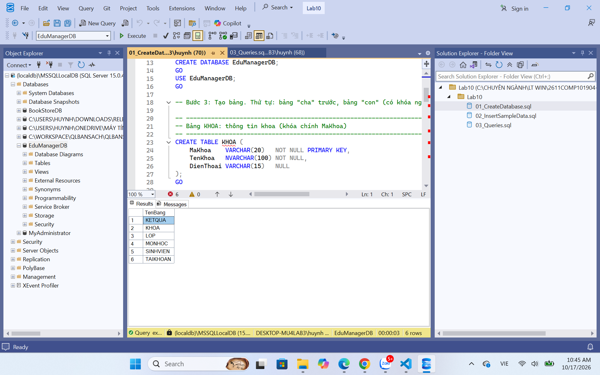

### 8.2. Nhập dữ liệu mẫu

Chạy `02_InsertSampleData.sql` thành công, không lỗi khóa ngoại vì nhập đúng thứ tự `KHOA → LOP → SINHVIEN/MONHOC → KETQUA`. Số dòng mỗi bảng:

| Bảng | KHOA | LOP | SINHVIEN | MONHOC | KETQUA | TAIKHOAN |
|---|---|---|---|---|---|---|
| Số dòng | 2 | 4 | 7 | 4 | 8 | 2 |

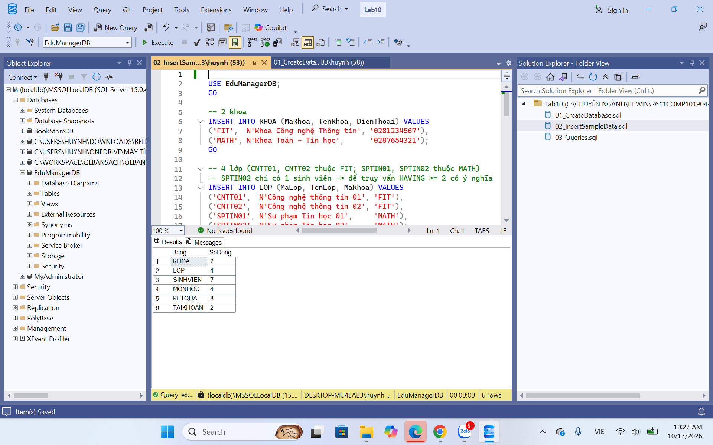

### 8.3. Truy vấn SELECT, UPDATE, DELETE

**Câu 1 – Liệt kê toàn bộ sinh viên:** trả về 7 dòng (SV001 đến SV007).

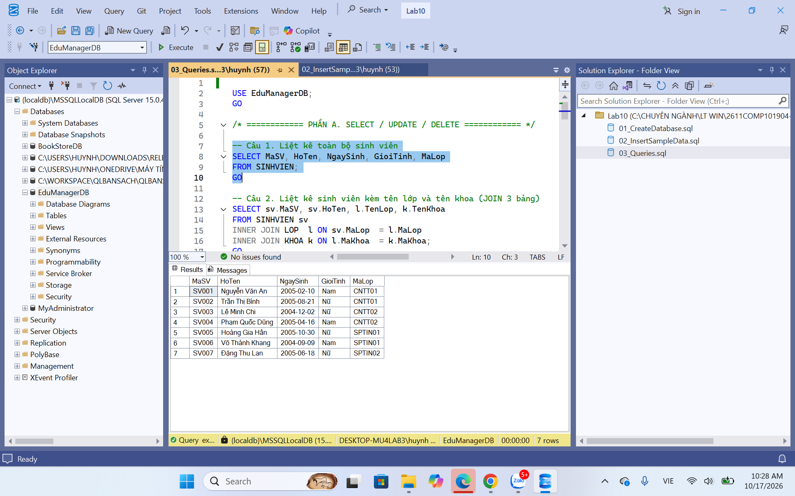

**Câu 2 – Sinh viên kèm tên lớp và tên khoa (JOIN 3 bảng):** trả về 7 dòng, mỗi sinh viên có tên lớp và tên khoa tương ứng.

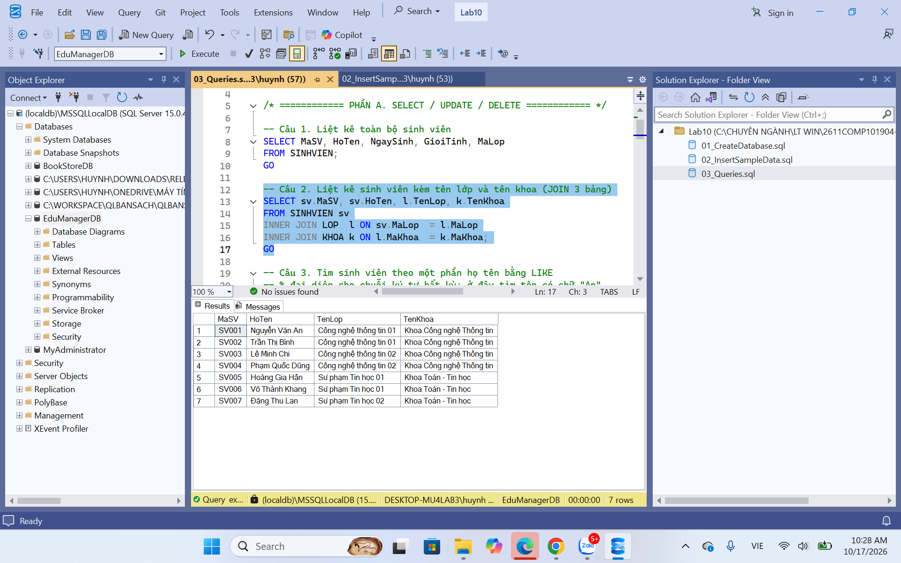

**Câu 3 – Tìm sinh viên theo họ tên bằng LIKE `%An%`:** trả về 3 dòng gồm Đặng Thu **Lan**, Nguyễn Văn **An**, Võ Thành Kh**ang**. SQL Server không phân biệt hoa thường nên các tên chứa "an" đều khớp.

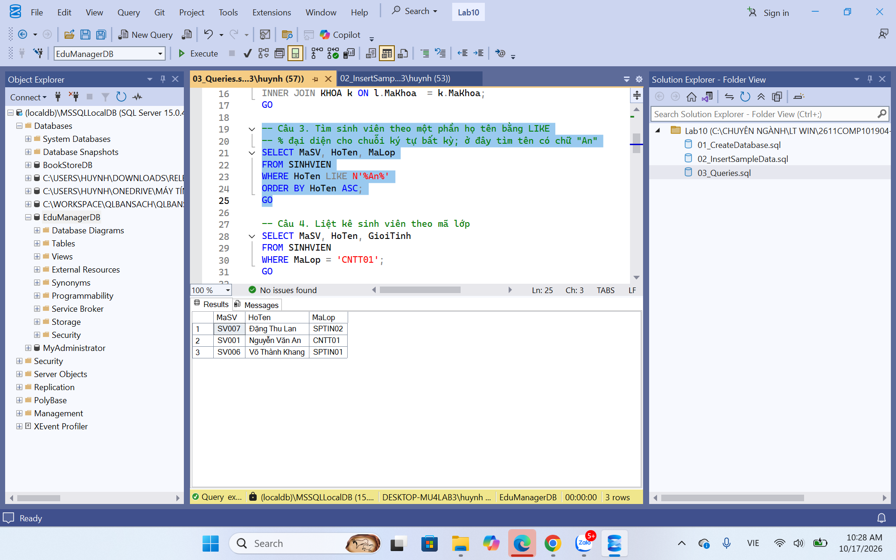

**Câu 4 – Sinh viên của lớp CNTT01:** trả về 2 dòng (SV001 Nguyễn Văn An – Nam, SV002 Trần Thị Bình – Nữ).

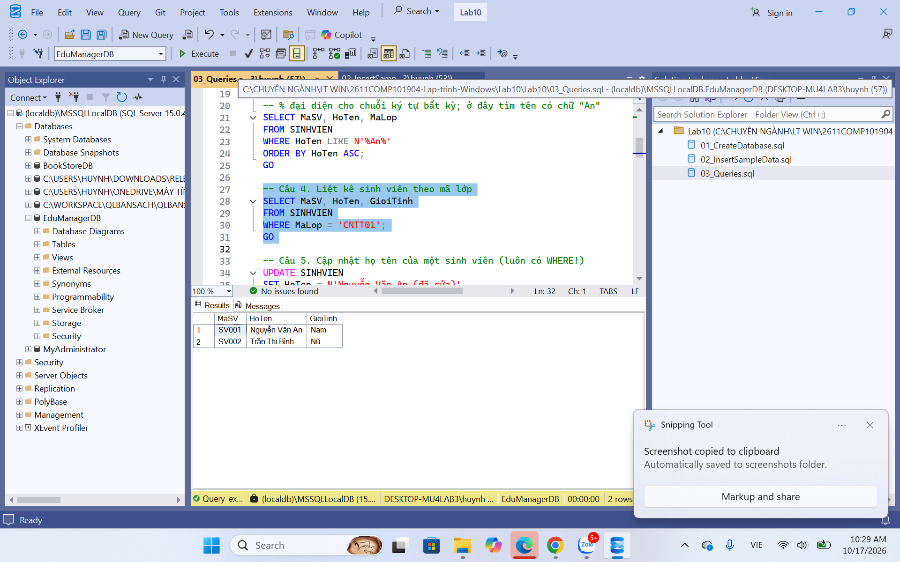

**Câu 5 – Cập nhật họ tên sinh viên SV001:** lệnh `UPDATE ... WHERE MaSV = 'SV001'` cập nhật 1 dòng (`1 row affected`), truy vấn kiểm tra cho thấy họ tên của SV001 đã đổi thành "Nguyễn Văn An (đã sửa)".

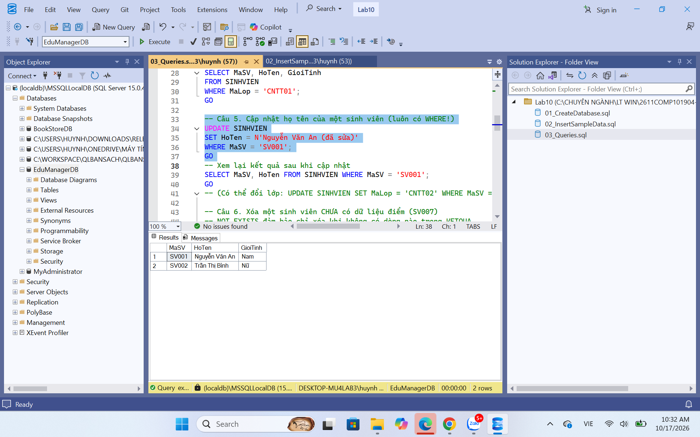

**Câu 6 – Xóa sinh viên chưa có điểm (SV007):** SV007 chưa có dòng nào trong `KETQUA` nên được xóa. Danh sách sinh viên còn lại 6 dòng (SV001 đến SV006).

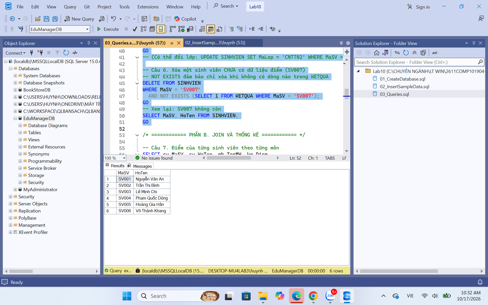

### 8.4. Truy vấn JOIN và thống kê

**Câu 7 – Điểm của từng sinh viên theo từng môn:** trả về 8 dòng, sắp xếp theo mã sinh viên và tên môn.

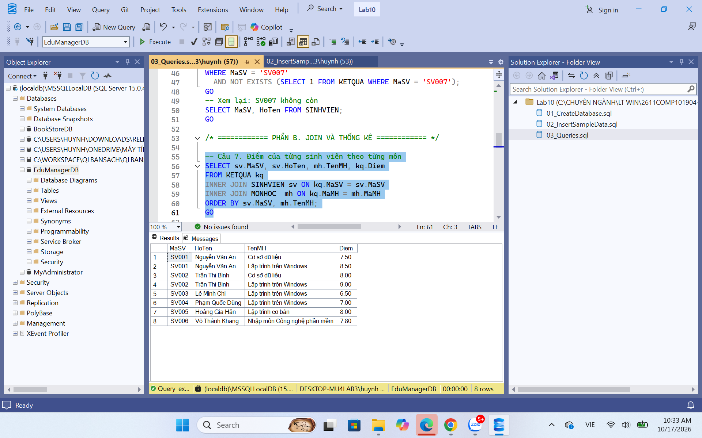

**Câu 8 – Điểm trung bình từng sinh viên:** trả về 6 dòng, SV007 không có trong kết quả vì không có điểm.

| MaSV | HoTen | DiemTrungBinh |
|---|---|---|
| SV001 | Nguyễn Văn An | 8.000000 |
| SV002 | Trần Thị Bình | 8.500000 |
| SV003 | Lê Minh Chi | 6.500000 |
| SV004 | Phạm Quốc Dũng | 7.000000 |
| SV005 | Hoàng Gia Hân | 8.000000 |
| SV006 | Võ Thành Khang | 7.800000 |

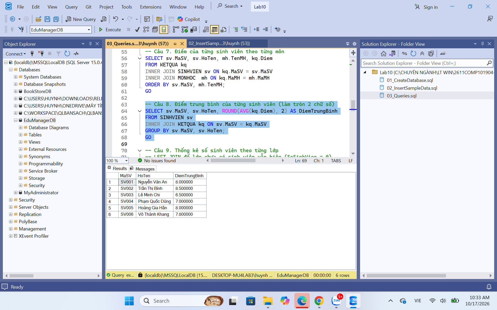

**Câu 9 – Số sinh viên theo từng lớp:** trả về 4 dòng. Lớp SPTIN02 vẫn hiện với 0 sinh viên nhờ `LEFT JOIN`.

| MaLop | TenLop | SoSinhVien |
|---|---|---|
| CNTT01 | Công nghệ thông tin 01 | 2 |
| CNTT02 | Công nghệ thông tin 02 | 2 |
| SPTIN01 | Sư phạm Tin học 01 | 2 |
| SPTIN02 | Sư phạm Tin học 02 | 0 |

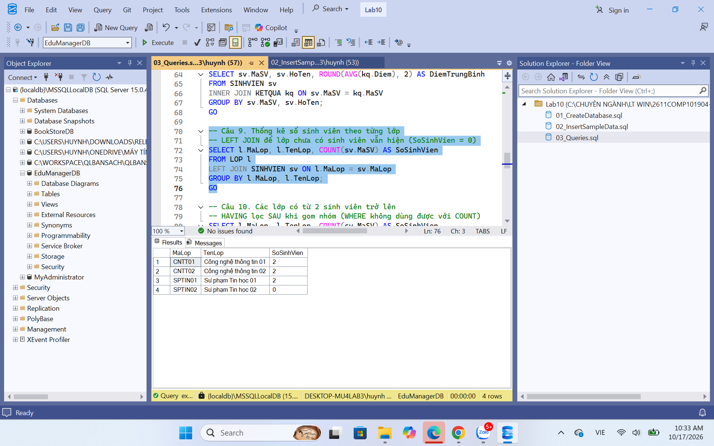

**Câu 10 – Các lớp có từ 2 sinh viên trở lên:** trả về 3 dòng. Lớp SPTIN02 (0 sinh viên) bị `HAVING COUNT(sv.MaSV) >= 2` loại bỏ.

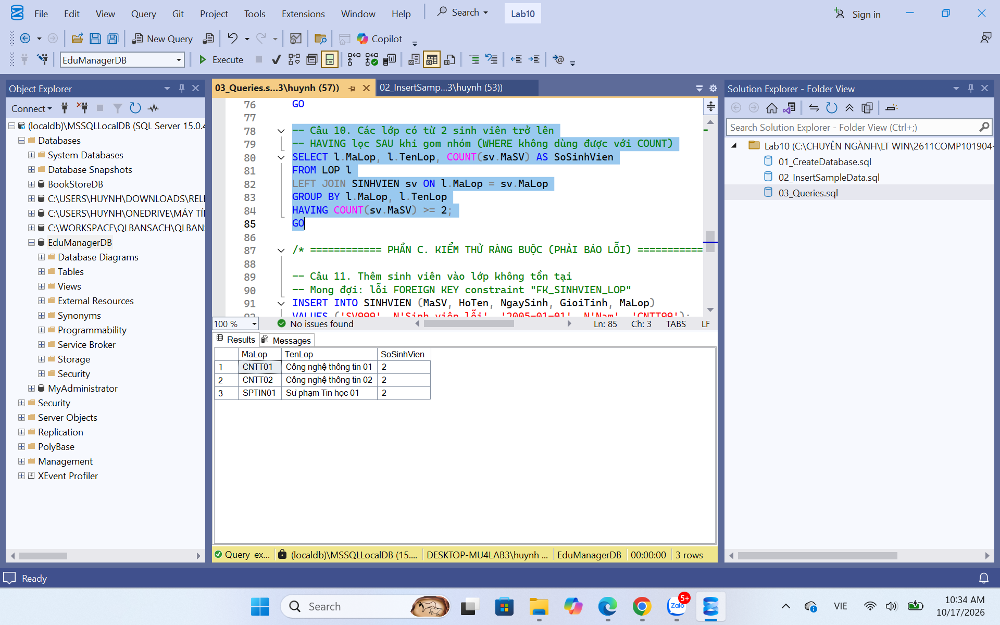

### 8.5. Kiểm thử ràng buộc (các lệnh đều báo lỗi, đúng như mong đợi)

| Câu | Lệnh test | Thông báo lỗi của SQL Server | Kết luận |
|---|---|---|---|
| 11 | Thêm SV999 vào lớp `CNTT99` (không tồn tại) | `Msg 547, Level 16, State 0, Line 91` – The INSERT statement conflicted with the FOREIGN KEY constraint "FK_SINHVIEN_LOP". The statement has been terminated. | Khóa ngoại chặn lớp không tồn tại |
| 12 | Nhập điểm 12 cho (SV003, COMP1020) | `Msg 547, Level 16, State 0, Line 98` – The INSERT statement conflicted with the CHECK constraint "CK_KETQUA_Diem". The statement has been terminated. | CHECK chặn điểm ngoài khoảng 0 đến 10 |
| 13 | Giới tính `Khác` | `Msg 547, Level 16, State 0, Line 104` – The INSERT statement conflicted with the CHECK constraint "CK_SINHVIEN_GioiTinh". The statement has been terminated. | CHECK chỉ cho phép Nam/Nữ |
| 14 | Thêm sinh viên trùng mã SV001 | `Msg 2627, Level 14, State 1, Line 110` – Violation of PRIMARY KEY constraint 'PK__SINHVIEN__2725081AD3CD7083'. The statement has been terminated. | Khóa chính chặn trùng mã |

**Câu 11 – Lỗi khóa ngoại:**

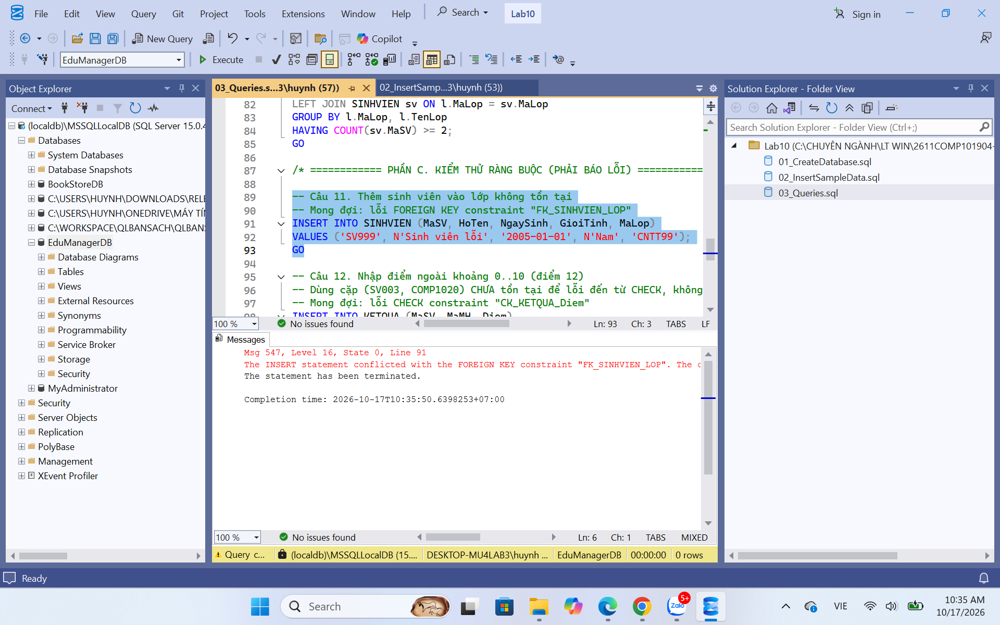

**Câu 12 – Lỗi CHECK điểm:**

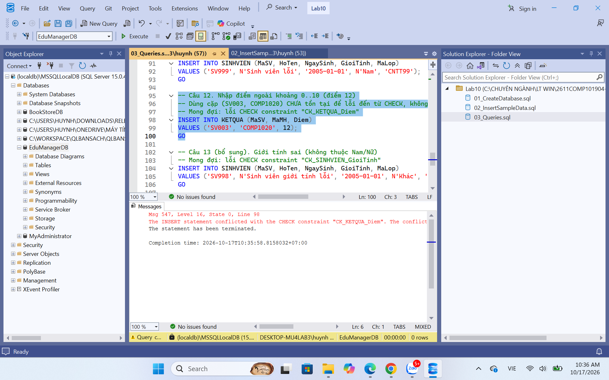

**Câu 13 – Lỗi CHECK giới tính:**

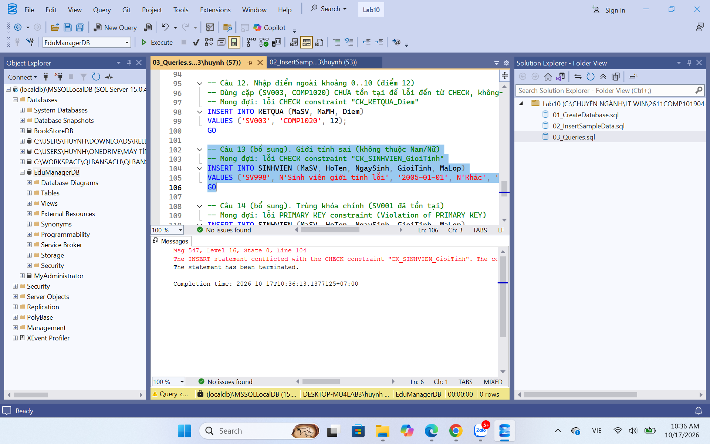

**Câu 14 – Lỗi khóa chính:**

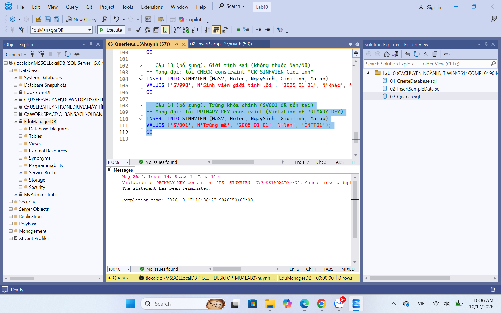

## 9. Nhận xét

- Cả 4 câu test lỗi đều bị SQL Server từ chối (`0 rows`), không có dòng dữ liệu sai nào được thêm vào, chứng tỏ khóa chính, khóa ngoại và các ràng buộc CHECK hoạt động đúng.
- Các truy vấn SELECT, JOIN, GROUP BY, HAVING trả về kết quả khớp với dữ liệu mẫu đã nhập.
- Khóa chính ghép `(MaSV, MaMH)` của `KETQUA` đảm bảo mỗi sinh viên chỉ có một điểm cho mỗi môn.
