# Lab 12 - Quản lý kết quả học tập (Data Binding, Stored Procedure, Transaction)

## Thông tin sinh viên

| Mục | Nội dung |
|---|---|
| Họ và tên | Huỳnh Thị Hồng Ân |
| MSSV | 49.01.103.006 |
| Lớp | 49.01.SPTIN.A |
| Học phần | COMP1019 - Lập trình trên Windows |
| Bài | Lab 12 - Data Binding, Stored Procedure và Transaction |

## Mô tả

Ứng dụng WinForms **Nhập điểm theo lớp**: người dùng chọn lớp và môn học, hệ thống hiển thị danh sách sinh viên của lớp
(kèm điểm nếu đã có). Người dùng nhập hoặc sửa **Điểm** và **Ghi chú**, rồi bấm **Lưu tất cả**.
Nếu mọi dòng hợp lệ thì toàn bộ được lưu xuống SQL Server trong **một transaction**;
nếu có bất kỳ dòng nào lỗi thì **rollback toàn bộ**, không dòng nào được ghi.

## Công nghệ sử dụng

- C# WinForms, .NET 8 (`net8.0-windows`)
- SQL Server (LocalDB `(localdb)\MSSQLLocalDB`), quản lý bằng SSMS
- ADO.NET với `Microsoft.Data.SqlClient`: `SqlConnection`, `SqlCommand`, `SqlDataAdapter`, `SqlTransaction`
- `DataTable` + `BindingSource` để binding dữ liệu vào `ComboBox` và `DataGridView`
- Stored procedure, sử dụng `SqlParameter` (không nối chuỗi SQL)

## Cấu trúc project

```
QLSinhVienLab12
├── Forms
│   ├── FrmNhapDiemTheoLop.cs            # sự kiện, validation, binding
│   └── FrmNhapDiemTheoLop.Designer.cs   # giao diện
├── DAL
│   ├── Database.cs                      # connection string
│   └── KetQuaDAL.cs                     # truy cập database, transaction
├── Database
│   └── QLSinhVienLab12.sql              # tạo database, bảng, dữ liệu mẫu, stored procedure
├── screenshots                          # ảnh minh họa
├── Program.cs
├── QLSinhVienLab12.csproj
└── README.md
```

## Yêu cầu class

| Lớp | Vai trò |
|---|---|
| `Database` | Chứa `ConnectionString` ở một nơi duy nhất |
| `KetQuaDAL` | `GetLop()`, `GetMonHoc()`, `GetKetQuaByLopMon()`, `SaveAll()`; mọi truy cập database đều gọi stored procedure có parameter |
| `FrmNhapDiemTheoLop` | Form với `cboLop`, `cboMonHoc`, `btnTaiDanhSach`, `dgvKetQua`, `btnLuuTatCa`, thanh trạng thái |

### Cấu trúc database

| Bảng | Cột | Ràng buộc |
|---|---|---|
| `LOP` | MaLop, TenLop | PK: MaLop |
| `SINHVIEN` | MaSV, HoTen, NgaySinh, MaLop | PK: MaSV; FK: MaLop → LOP |
| `MONHOC` | MaMon, TenMon, SoTinChi | PK: MaMon |
| `KETQUA` | MaSV, MaMon, Diem, GhiChu | PK: (MaSV, MaMon); FK → SINHVIEN, MONHOC; `CHECK (Diem BETWEEN 0 AND 10)` |

| Stored procedure | Chức năng |
|---|---|
| `sp_Lop_GetAll` | Lấy danh sách lớp |
| `sp_MonHoc_GetAll` | Lấy danh sách môn học |
| `sp_KetQua_GetByLopMon` | Lấy sinh viên của lớp kèm điểm nếu đã có (LEFT JOIN, chưa có điểm thì `NULL`) |
| `sp_KetQua_Save` | Upsert: đã có điểm thì UPDATE, chưa có thì INSERT |

## Chức năng

1. Mở Form: nạp danh sách lớp và môn học vào `ComboBox`.
2. Chọn lớp và môn học, bấm **Tải danh sách** để hiển thị sinh viên lên `DataGridView`.
3. Nhập hoặc sửa cột **Điểm** và **Ghi chú** (Mã SV, Họ tên chỉ đọc).
4. Kiểm tra điểm: không rỗng, phải là số, nằm trong khoảng 0 đến 10. Dòng chưa có điểm hợp lệ hiện **dấu X đỏ** và nền hồng.
5. **Lưu tất cả** bằng transaction; có lỗi thì rollback và thông báo; thành công thì commit và báo số dòng đã lưu.
6. Mở rộng: ô **Tìm kiếm** lọc theo Mã SV hoặc Họ tên; dòng **Thống kê** (số sinh viên, đã nhập, trung bình, cao nhất, thấp nhất).

## Hướng dẫn cài đặt và chạy

### Cài đặt database

1. Mở SQL Server Management Studio, kết nối tới `(localdb)\MSSQLLocalDB`.
2. Mở file `Database/QLSinhVienLab12.sql` và nhấn **Execute (F5)**. Script tạo database `QLSinhVienLab12`, 4 bảng, dữ liệu mẫu và 4 stored procedure. Có thể chạy lại nhiều lần (script tạo lại database từ đầu).
3. Kiểm tra: `SELECT * FROM KETQUA;` phải có 2 dòng (SV001 = 8.5, SV002 = 7).
4. Sửa connection string trong `DAL/Database.cs` nếu dùng server khác, ví dụ `.\SQLEXPRESS`:

```csharp
public static string ConnectionString =
    "Data Source=(localdb)\\MSSQLLocalDB;Initial Catalog=QLSinhVienLab12;" +
    "Integrated Security=True;TrustServerCertificate=True";
```

### Chạy chương trình

1. Mở project `QLSinhVienLab12.csproj` bằng Visual Studio 2022.
2. Build solution (package `Microsoft.Data.SqlClient` tự được restore).
3. Nhấn **F5** để chạy.

Tài khoản demo: không có (ứng dụng không có đăng nhập).

## Xử lý dữ liệu nhập

| Trường hợp | Kết quả |
|---|---|
| Điểm để trống | Hiện dấu X đỏ; bấm Lưu bị chặn, báo "Điểm không được để trống" |
| Điểm không phải số (vd `abc`) | Hộp thoại "Điểm phải là một số" |
| Điểm ngoài 0-10 (vd `15`) | Hộp thoại "Điểm phải nằm trong khoảng từ 0 đến 10" |
| Nhập `8,5` hoặc `8.5` | Cả hai đều được chấp nhận |
| Đổi lớp hoặc môn sau khi đã tải | Danh sách bị xóa, phải bấm Tải lại (tránh lưu nhầm môn) |
| SQL Server từ chối một dòng khi lưu | `Rollback()` toàn bộ, không dòng nào được ghi |

## Kết quả kiểm thử

| # | Thao tác | Kết quả |
|---|---|---|
| 1 | Chọn K47A, Lập trình trên Windows, bấm Tải | Hiển thị 5 sinh viên; SV001 = 8.5, SV002 = 7; 3 sinh viên chưa có điểm hiện dấu X đỏ |
| 2 | Bấm Lưu khi còn ô trống | Cảnh báo SV003, SV004, SV005; không lưu gì |
| 3 | Nhập `15` | Cảnh báo điểm ngoài khoảng 0-10, giữ lại ô để sửa |
| 4 | Nhập `abc` | Cảnh báo điểm phải là số |
| 5 | Nhập đủ điểm hợp lệ, bấm Lưu tất cả | "Đã lưu thành công 5 dòng"; bảng `KETQUA` có 5 dòng |
| 6 | Sửa điểm SV001 thành 9, bấm Lưu | Cập nhật dòng cũ (UPDATE), không tạo dòng mới |
| 7 | Gõ "Trần Thị Bình" ở ô tìm kiếm | Chỉ còn SV002; thanh trạng thái "Tìm thấy 1 sinh viên" |
| 8 | Rollback: thêm ràng buộc tạm `CK_Demo` (Ghi chú không được là `LOI`), nhập 4 dòng và SV005 có Ghi chú `LOI`, bấm Lưu | Thông báo rollback; `KETQUA` vẫn còn 2 dòng cũ (SV001 = 8.5) |

Cách tạo tình huống rollback trong test 8 (không cần sửa code), sau khi chạy xong thì xóa ràng buộc:

```sql
ALTER TABLE KETQUA ADD CONSTRAINT CK_Demo CHECK (GhiChu <> N'LOI');
-- ... thực hiện lưu trên Form ...
ALTER TABLE KETQUA DROP CONSTRAINT CK_Demo;
```

## Hình ảnh màn hình

### 1. Tải danh sách, trước khi lưu
Sinh viên chưa có điểm hiện dấu X đỏ và nền hồng.

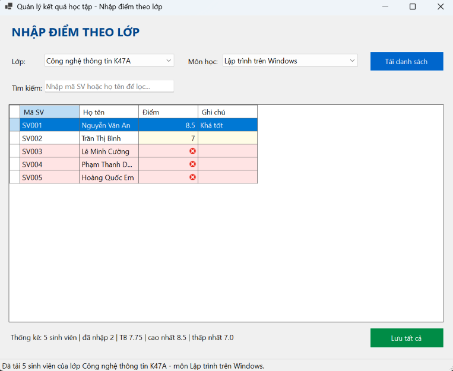

### 2. Tải danh sách môn chưa có điểm nào

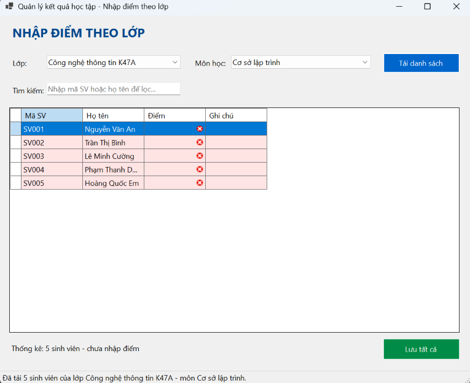

### 3. Bấm Lưu khi còn ô trống

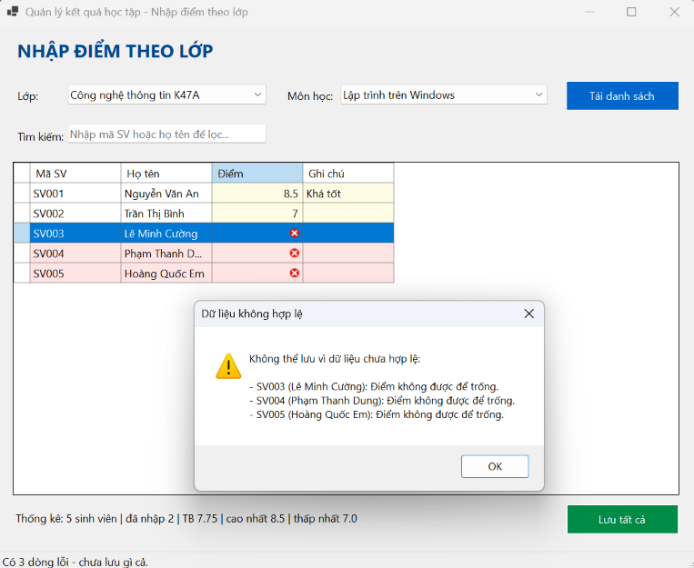

### 4. Validation: điểm ngoài khoảng 0-10

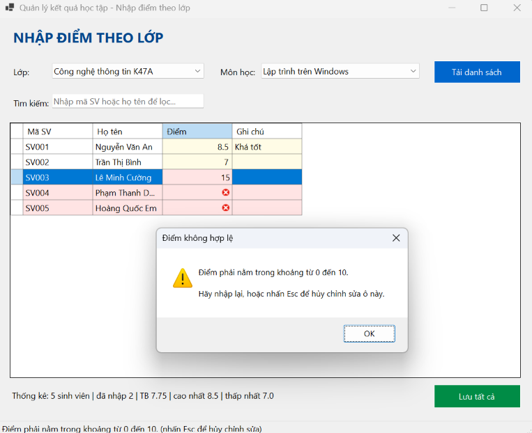

### 5. Validation: điểm không phải số

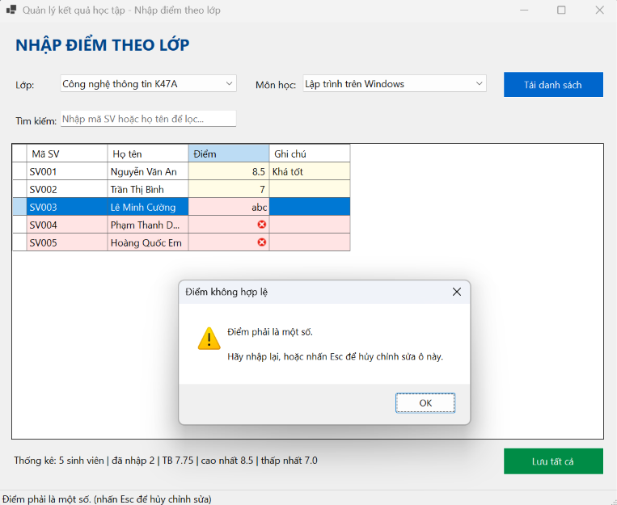

### 6. Lưu thành công

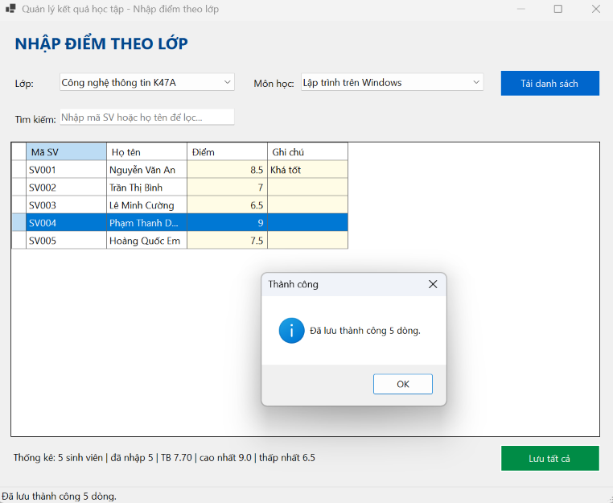

### 7. Sửa điểm đã có (UPDATE)

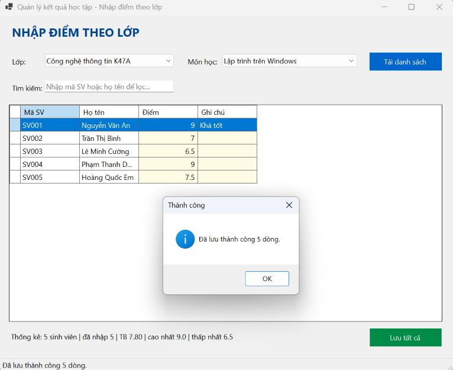

### 8. Dữ liệu bảng KETQUA trong SSMS sau khi lưu

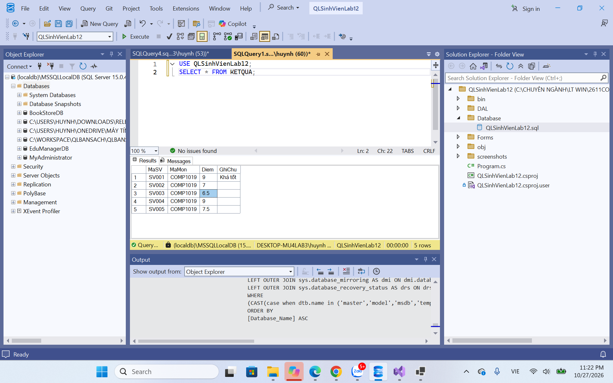

### 9. Tìm kiếm

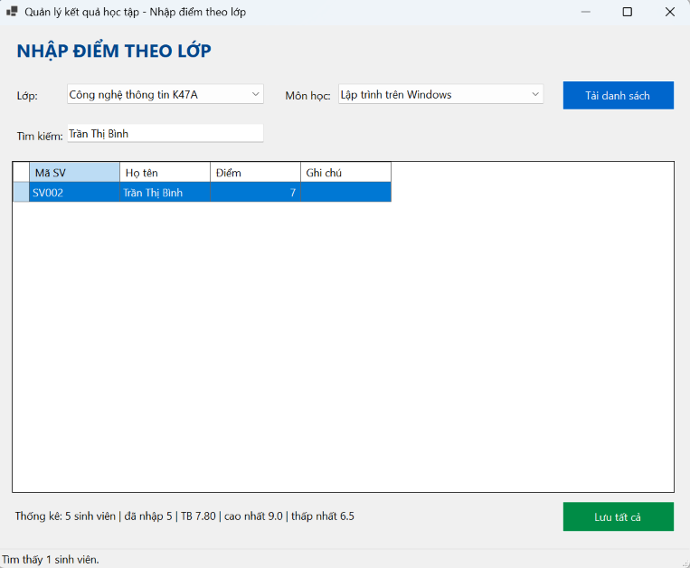

### 10. Rollback khi một dòng lỗi

Thông báo lỗi và toàn bộ thao tác bị hủy:

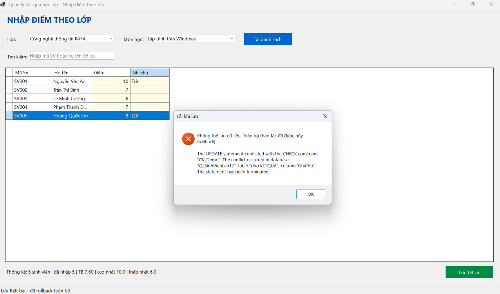

Sau khi rollback, bảng `KETQUA` vẫn còn 2 dòng cũ (SV001 = 8.5, SV002 = 7):

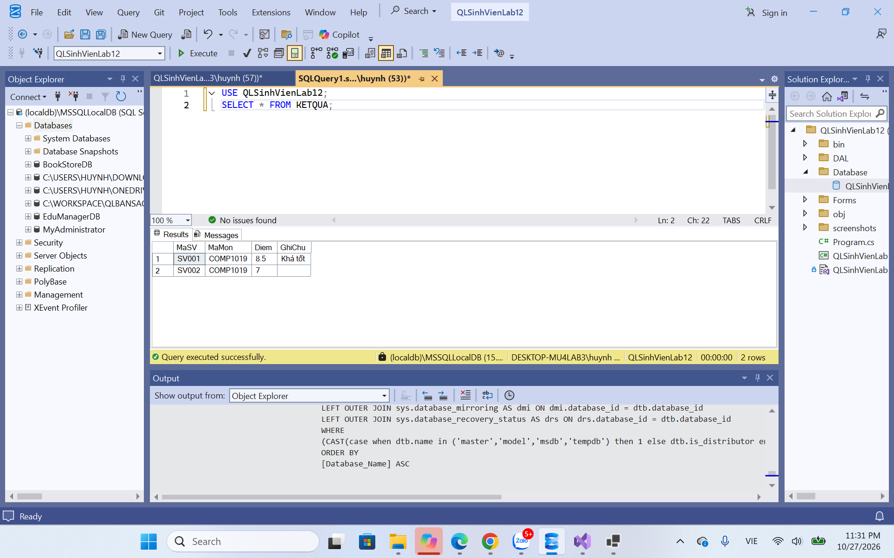
