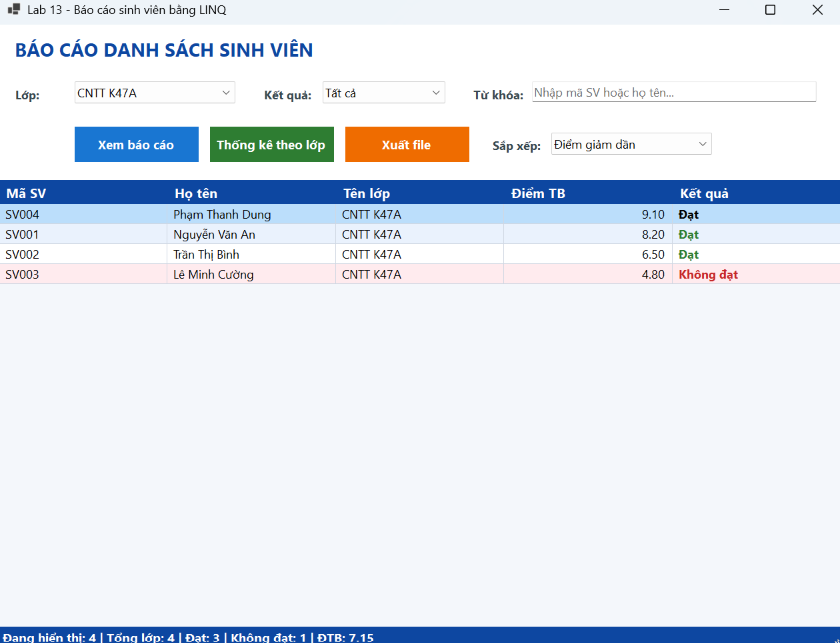
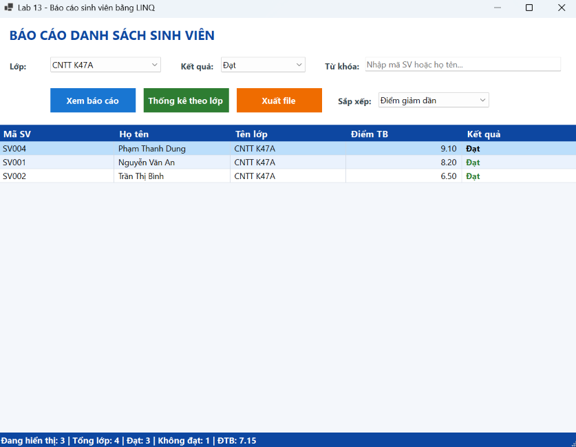
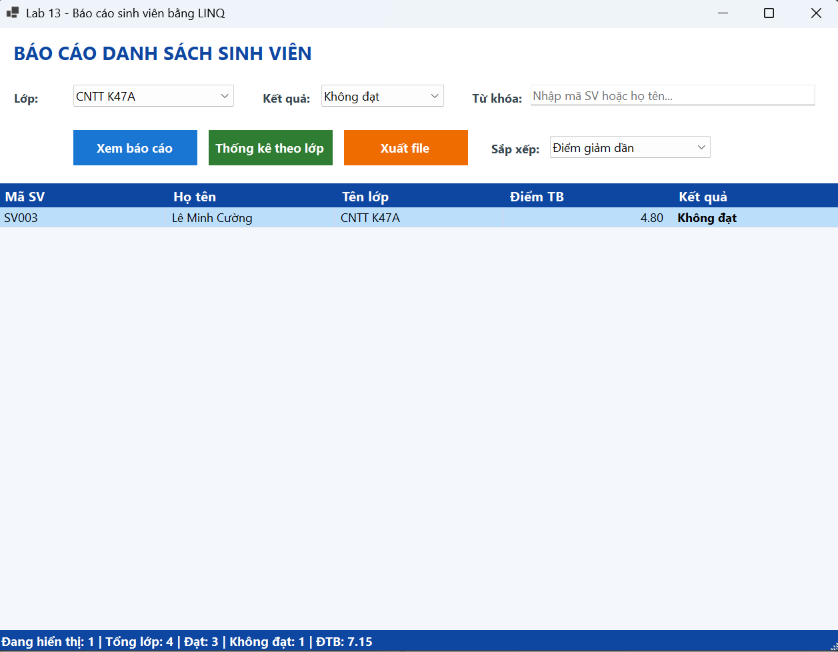
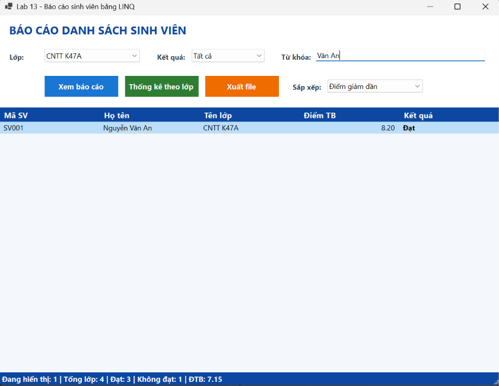
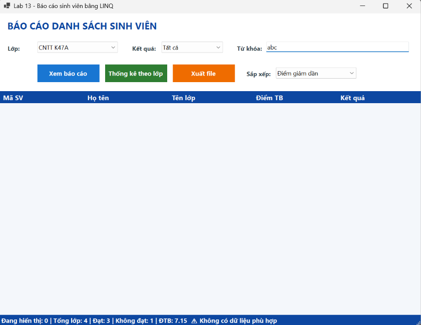
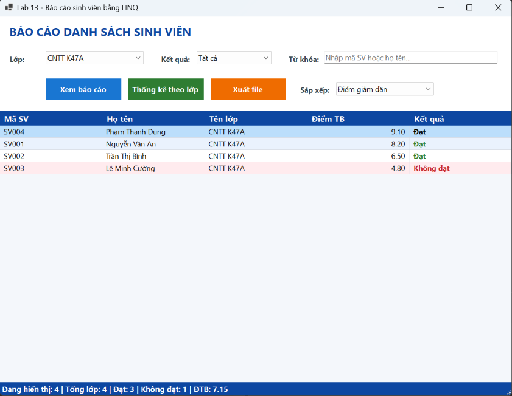
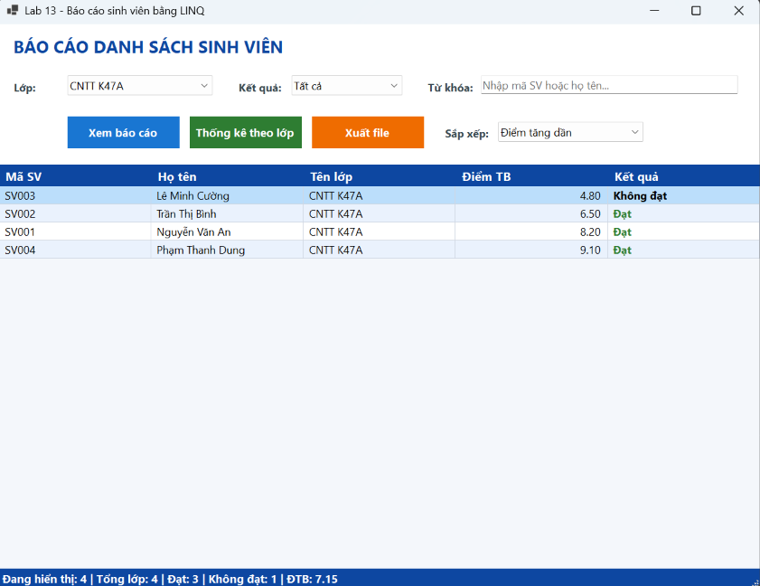
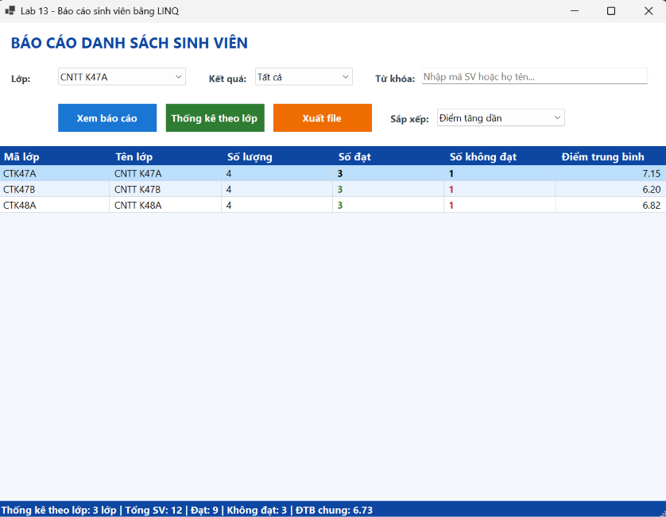
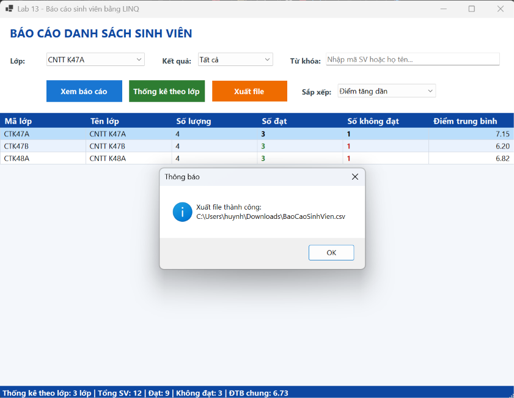

# Lab 13 - Báo cáo sinh viên bằng LINQ

## 1. Thông tin sinh viên

| Thông tin | Nội dung |
|---|---|
| Họ và tên | Huỳnh Thị Hồng Ân |
| MSSV | 49.01.103.006 |
| Lớp | 49.01.SPTIN.A |
| Học phần | COMP1019 - Lập trình trên Windows |
| Bài | Lab 13 - Báo cáo sinh viên bằng LINQ |

## 2. Mô tả

Module **Báo cáo danh sách sinh viên theo lớp** viết bằng C# WinForms. Người dùng chọn lớp, chọn điều kiện kết quả học tập (Tất cả / Đạt / Không đạt), nhập từ khóa tìm theo mã hoặc họ tên rồi bấm **Xem báo cáo**. Chương trình dùng LINQ để lọc, sắp xếp, nhóm và thống kê dữ liệu, hiển thị trên `DataGridView`, và cho phép xuất kết quả ra file **CSV** hoặc **TXT**.

Dữ liệu được tạo sẵn trong bộ nhớ (12 sinh viên, 3 lớp), không dùng database.

## 3. Công nghệ sử dụng

- C# / .NET 8 - Windows Forms
- LINQ (`Where`, `OrderByDescending`, `ThenBy`, `Select`, `Distinct`, `GroupBy`, `Count`, `Average`, `Sum`)
- `DataGridView`, `ComboBox`, `TextBox`, `StatusStrip`
- `SaveFileDialog`, `StringBuilder`, `File.WriteAllText` (UTF-8)
- Không dùng DevExpress hay Crystal Reports

## 4. Cấu trúc project

```
StudentReportDemo
│
├── Models
│   └── SinhVien.cs
│
├── Forms
│   ├── FrmBaoCaoSinhVien.cs
│   └── FrmBaoCaoSinhVien.Designer.cs
│
├── output                      // file báo cáo đã xuất
│   ├── BaoCaoSinhVien_CTK47A.csv
│   ├── BaoCaoSinhVien_CTK47A.txt
│   └── ThongKeTheoLop.csv
│
├── screenshots
├── Program.cs
└── StudentReportDemo.csproj
```

## 5. Yêu cầu class

### Class `SinhVien` (Models/SinhVien.cs)

| Thuộc tính | Kiểu | Ý nghĩa |
|---|---|---|
| `MaSV` | `string` | Mã sinh viên |
| `HoTen` | `string` | Họ tên sinh viên |
| `MaLop` | `string` | Mã lớp |
| `TenLop` | `string` | Tên lớp |
| `Diem` | `double` | Điểm trung bình |
| `KetQua` | `string` (chỉ đọc) | `"Đạt"` nếu `Diem >= 5`, ngược lại `"Không đạt"` |

`KetQua` được tính từ `Diem` nên không lưu riêng, tránh trường hợp điểm đã đổi mà kết quả chưa cập nhật.

### Form `FrmBaoCaoSinhVien` (Forms/FrmBaoCaoSinhVien.cs)

| Control | Tên | Chức năng |
|---|---|---|
| ComboBox | `cboLop` | Chọn lớp |
| ComboBox | `cboKetQua` | Chọn Tất cả / Đạt / Không đạt |
| ComboBox | `cboSapXep` | Chọn sắp xếp điểm giảm dần / tăng dần |
| TextBox | `txtTuKhoa` | Tìm theo mã hoặc họ tên |
| Button | `btnXemBaoCao` | Lọc dữ liệu |
| Button | `btnThongKe` | Thống kê theo lớp |
| Button | `btnXuatFile` | Xuất báo cáo CSV/TXT |
| DataGridView | `dgvBaoCao` | Hiển thị kết quả |
| StatusStrip | `stsThongKe` / `lblThongKe` | Tổng số SV, số đạt, số không đạt, điểm TB |

Các hàm được tách riêng: `TaoDuLieuMau()`, `LoadComboBox()`, `XemBaoCao()`, `CapNhatThongKe()`, `ThongKeTheoLop()`, `XuatFile()`.

## 6. Chức năng

1. **Khi mở Form**: tạo dữ liệu mẫu, nạp danh sách lớp vào `cboLop` (LINQ `Select` + `Distinct` + `OrderBy`) và nạp các lựa chọn vào `cboKetQua`, sau đó hiển thị báo cáo lớp đầu tiên.
2. **Xem báo cáo**: lọc theo lớp, kết quả học tập và từ khóa bằng `Where`; sắp xếp theo điểm **giảm dần** (`OrderByDescending`, mặc định) hoặc **tăng dần** (`OrderBy`) tùy lựa chọn ở `cboSapXep`, cùng điểm thì theo họ tên (`ThenBy`); chọn cột hiển thị bằng `Select`.
3. **Tự cập nhật**: đổi lớp, đổi kết quả, đổi kiểu sắp xếp hoặc gõ từ khóa thì lưới tự lọc lại.
4. **Thống kê theo lớp**: `GroupBy` theo lớp, tính số lượng, số đạt, số không đạt và điểm trung bình từng lớp.
5. **StatusStrip**: hiển thị số dòng đang hiển thị, tổng số SV của lớp, số đạt, số không đạt, ĐTB.
6. **Giao diện có màu**: nút *Xem báo cáo* xanh dương, *Thống kê* xanh lá, *Xuất file* cam; tiêu đề cột và thanh trạng thái màu xanh đậm; dòng xen kẽ màu nhạt; sinh viên **Không đạt** được tô nền hồng, chữ đỏ, còn **Đạt** chữ xanh lá (sự kiện `CellFormatting`).
7. **Xuất file**: lưu dữ liệu đang hiển thị trên lưới (báo cáo hoặc bảng thống kê) ra CSV (phân cách bằng dấu phẩy) hoặc TXT (phân cách bằng tab, có tiêu đề và ngày xuất).

## 7. Cách chạy

1. Clone repository:
   ```bash
   git clone <link-repo>
   ```
2. Mở `StudentReportDemo.csproj` bằng Visual Studio 2022 (cần .NET 8 SDK, workload *.NET desktop development*).
3. Nhấn **F5** (hoặc chạy lệnh `dotnet run` trong thư mục project).

## 8. Xử lý dữ liệu nhập

| Trường hợp | Cách xử lý |
|---|---|
| ComboBox chưa có `SelectedValue` khi đang nạp dữ liệu | Dùng cờ `dangKhoiTao` để chặn sự kiện, và `XemBaoCao()` kiểm tra `SelectedValue == null` thì dừng |
| Không có sinh viên phù hợp | Bấm *Xem báo cáo*: hiện MessageBox thông báo. Khi tự lọc lúc gõ từ khóa: chỉ báo trên StatusStrip để không bật hộp thoại mỗi lần gõ phím |
| Tính `Average` trên danh sách rỗng | Kiểm tra `tongSo > 0` trước khi tính |
| Từ khóa có khoảng trắng / chữ hoa | `Trim()` và `ToLower()` trước khi so sánh |
| Xuất file khi lưới rỗng | Thông báo "Không có dữ liệu để xuất" |
| Nội dung có dấu phẩy khi xuất CSV | Bọc giá trị trong dấu `"..."` theo chuẩn CSV |
| Máy dùng định dạng số tiếng Việt (`8,2`) | Ghi số thực theo `InvariantCulture` (`8.2`) để không lệch cột CSV |
| File đang mở trong Excel / không có quyền ghi | `try-catch` bắt `IOException`, `UnauthorizedAccessException` và báo lỗi rõ ràng |
| Tiếng Việt bị lỗi font khi mở CSV bằng Excel | Ghi file bằng UTF-8 có BOM |

## 9. Hình ảnh màn hình

### 9.1. Màn hình chính khi mở chương trình
Form tự nạp lớp **CNTT K47A**, Kết quả = *Tất cả*, Sắp xếp = *Điểm giảm dần*. Lưới hiện 4 sinh viên theo điểm 9.10 → 8.20 → 6.50 → 4.80. Dòng **Không đạt** (Lê Minh Cường, 4.80) được tô nền hồng, chữ đỏ. Thanh trạng thái: *Đang hiển thị: 4 | Tổng lớp: 4 | Đạt: 3 | Không đạt: 1 | ĐTB: 7.15*.



### 9.2. Lọc sinh viên "Đạt"
Chọn Kết quả = **Đạt** (LINQ `Where(sv => sv.Diem >= 5)`). Lưới còn 3 sinh viên, thanh trạng thái báo *Đang hiển thị: 3*.



### 9.3. Lọc sinh viên "Không đạt"
Chọn Kết quả = **Không đạt** (LINQ `Where(sv => sv.Diem < 5)`). Lưới chỉ còn SV003 - Lê Minh Cường (4.80), *Đang hiển thị: 1*.



### 9.4. Tìm kiếm theo từ khóa
Gõ **"Văn An"** vào ô Từ khóa, lưới tự lọc ngay khi gõ (tìm theo mã hoặc họ tên, không phân biệt hoa thường). Kết quả: SV001 - Nguyễn Văn An (8.20).



### 9.5. Không có dữ liệu phù hợp
Gõ từ khóa **"abc"** không khớp sinh viên nào. Lưới trống và thanh trạng thái báo *Đang hiển thị: 0 ... ⚠ Không có dữ liệu phù hợp*. (Nếu bấm nút *Xem báo cáo* thì chương trình hiện thêm hộp thông báo.)



### 9.6. Sắp xếp điểm giảm dần
Xóa ô Từ khóa, lưới hiển thị lại đủ 4 sinh viên của lớp.



### 9.7. Sắp xếp điểm tăng dần
Chọn Sắp xếp = **Điểm tăng dần** (LINQ `OrderBy(sv => sv.Diem)`). Thứ tự đổi thành 4.80 → 6.50 → 8.20 → 9.10.



### 9.8. Thống kê theo lớp
Bấm **Thống kê theo lớp** (LINQ `GroupBy` + `Count` + `Average`). Mỗi lớp có 4 sinh viên, 3 đạt, 1 không đạt; điểm trung bình: CTK47A **7.15**, CTK47B **6.20**, CTK48A **6.82**. Cột *Số đạt* chữ xanh lá, *Số không đạt* chữ đỏ. Thanh trạng thái: *3 lớp | Tổng SV: 12 | Đạt: 9 | Không đạt: 3 | ĐTB chung: 6.73*.



### 9.9. Xuất file thành công
Bấm **Xuất file**, chọn nơi lưu bằng `SaveFileDialog`. Chương trình xuất dữ liệu đang hiển thị (bảng thống kê) ra `BaoCaoSinhVien.csv` và báo *Xuất file thành công* kèm đường dẫn file.



## 10. File báo cáo đã xuất

- [output/BaoCaoSinhVien_CTK47A.csv](output/BaoCaoSinhVien_CTK47A.csv): danh sách lớp CNTT K47A (CSV)
- [output/BaoCaoSinhVien_CTK47A.txt](output/BaoCaoSinhVien_CTK47A.txt): danh sách lớp CNTT K47A (TXT)
- [output/ThongKeTheoLop.csv](output/ThongKeTheoLop.csv): bảng thống kê theo lớp
