# Lab 14 – Entity Framework và mô hình ba lớp (EduManager – Quản lý môn học)

## 👩‍🎓 Thông tin sinh viên

| Thông tin | Nội dung |
|---|---|
| Họ và tên | Huỳnh Thị Hồng Ân |
| MSSV | 49.01.103.006 |
| Lớp | 49.01.SPTIN.A |
| Môn học | COMP1019 – Lập trình trên Windows |
| Bài | Buổi 14 – Lab 14: Entity Framework và mô hình ba lớp |

## 📌 Mô tả

Module **Quản lý môn học** của hệ thống **EduManager**. Ứng dụng Windows Forms cho phép xem, thêm, sửa, xóa
và tìm kiếm môn học lưu trong SQL Server. Dữ liệu được truy cập bằng **Entity Framework Core**, mã nguồn được
tổ chức theo **mô hình ba lớp GUI – BLL – DAL**.

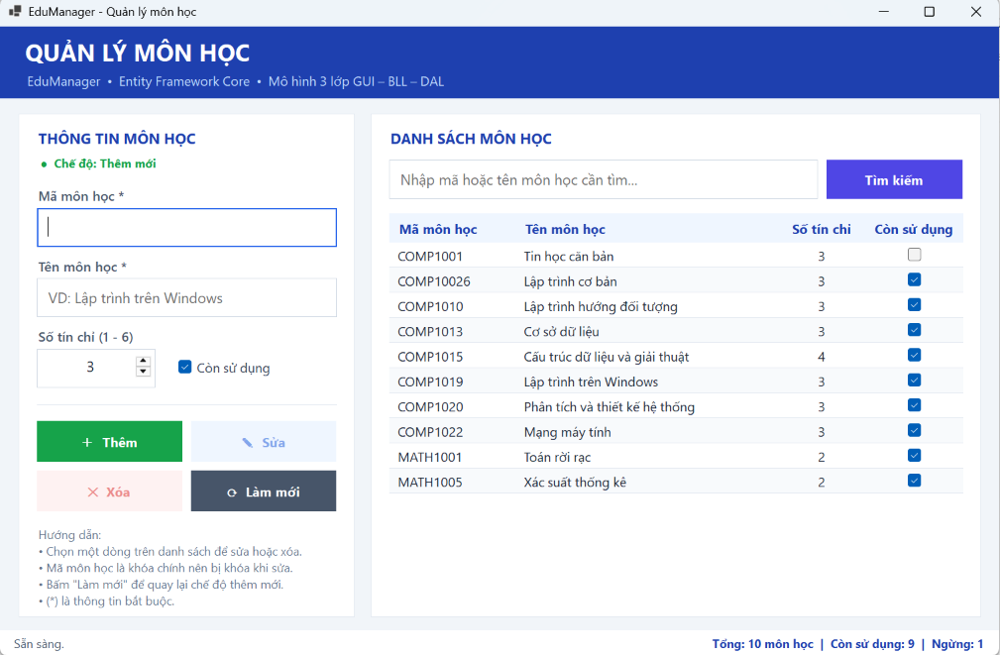

## 🛠 Công nghệ sử dụng

- Ngôn ngữ: **C#**, **.NET 8**, **Windows Forms**
- ORM: **Entity Framework Core 8** (`Microsoft.EntityFrameworkCore.SqlServer`, `Microsoft.EntityFrameworkCore.Tools`)
- Cơ sở dữ liệu: **SQL Server LocalDB** – database `EduManagerDB`, bảng `MONHOC`
- Công cụ: Visual Studio 2022, SQL Server Management Studio (SSMS)
- Kiến trúc: **Mô hình 3 lớp** (GUI – BLL – DAL)

## 🧱 Cấu trúc project

```
Lab14
├── EduManager.sln
├── EduManager
│   ├── Models
│   │   └── MonHoc.cs              # Entity ánh xạ bảng MONHOC
│   ├── Data
│   │   └── EduManagerContext.cs   # DbContext + chuỗi kết nối + cấu hình bảng
│   ├── DAL
│   │   └── MonHocDAL.cs           # Truy cập database bằng EF Core
│   ├── BLL
│   │   └── MonHocBLL.cs           # Kiểm tra dữ liệu (validation) trước khi gọi DAL
│   ├── GUI
│   │   ├── FrmMonHoc.cs           # Xử lý sự kiện, gọi BLL, hiển thị kết quả
│   │   └── FrmMonHoc.Designer.cs  # Thiết kế giao diện
│   ├── Program.cs
│   └── EduManager.csproj
├── Database
│   └── EduManagerDB_MonHoc.sql    # Script tạo database, bảng và dữ liệu mẫu
├── docs
│   └── screenshots                # Ảnh minh chứng
├── README.md
└── .gitignore
```

## 📋 Yêu cầu class

| Lớp | Thuộc tầng | Trách nhiệm |
|---|---|---|
| `MonHoc` | Models | Entity gồm `MaMonHoc`, `TenMonHoc`, `SoTinChi`, `TrangThai` |
| `EduManagerContext` | Data | Kế thừa `DbContext`, có `DbSet<MonHoc>`, cấu hình khóa chính, độ dài cột, CHECK số tín chỉ 1–6 |
| `MonHocDAL` | DAL | `GetAll`, `Search`, `GetById`, `Exists`, `Insert`, `Update`, `Delete` – chỉ thao tác dữ liệu bằng LINQ/EF Core |
| `MonHocBLL` | BLL | `LayDanhSach`, `TimKiem`, `Them`, `Sua`, `Xoa` – chuẩn hóa, kiểm tra dữ liệu, đổi lỗi database thành thông báo dễ hiểu |
| `BusinessException` | BLL | Ngoại lệ nghiệp vụ chứa câu thông báo để GUI hiển thị |
| `FrmMonHoc` | GUI | Nhận dữ liệu, gọi BLL, hiển thị kết quả – **không** viết SQL, **không** chứa logic kiểm tra nghiệp vụ |

Luồng xử lý: `FrmMonHoc (GUI) → MonHocBLL (BLL) → MonHocDAL (DAL) → EduManagerContext → SQL Server`

## 🗄 Cấu trúc database

Bảng `MONHOC` trong database `EduManagerDB`:

| Cột | Kiểu dữ liệu | Ràng buộc | Ý nghĩa |
|---|---|---|---|
| MaMonHoc | nvarchar(10) | PRIMARY KEY, NOT NULL | Mã môn học |
| TenMonHoc | nvarchar(100) | NOT NULL | Tên môn học |
| SoTinChi | int | CHECK 1–6 | Số tín chỉ |
| TrangThai | bit | DEFAULT 1 | 1 = còn sử dụng, 0 = ngừng |

## ⚙️ Chức năng

1. Load danh sách môn học khi mở Form.
2. Thêm môn học mới.
3. Sửa thông tin môn học (mã môn học bị khóa vì là khóa chính).
4. Xóa môn học sau khi xác nhận bằng MessageBox.
5. Tìm kiếm theo mã **hoặc** tên (bấm nút *Tìm kiếm* hoặc nhấn Enter).
6. Chọn một dòng trên DataGridView → dữ liệu hiển thị lại lên các ô nhập.
7. Làm mới Form và load lại danh sách.

Bổ sung về giao diện:
- Nhãn **Chế độ: Thêm mới / Sửa – Xóa** cho biết đang thao tác gì.
- Nút chưa dùng được hiển thị màu nhạt; ô đang nhập có viền xanh.
- Thanh trạng thái thống kê tổng số môn, số môn còn sử dụng và ngừng sử dụng.

## ▶️ Cách chạy

### 1. Phục hồi database

1. Mở **SQL Server Management Studio**, kết nối tới `(localdb)\MSSQLLocalDB`
   (hoặc tên SQL Server trên máy bạn).
2. Mở file **`Database/EduManagerDB_MonHoc.sql`** và bấm **Execute**.
3. Script sẽ tạo database `EduManagerDB`, bảng `MONHOC` và 10 môn học mẫu.
   Kết quả đúng là tab *Results* hiện 10 dòng:

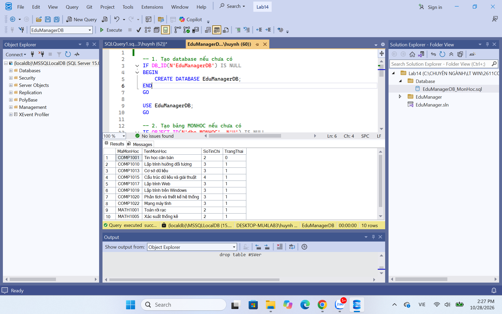

> **Nếu database `EduManagerDB` đã có bảng `MONHOC` cũ** (từ bài lab trước) với tên cột khác
> (ví dụ `MaMH`, `TenMH`), script sẽ báo *Invalid column name*. Khi đó đổi tên bảng cũ
> và các ràng buộc của nó, rồi chạy lại script:
>
> ```sql
> USE EduManagerDB;
> EXEC sp_rename 'dbo.MONHOC', 'MONHOC_CU';
> IF OBJECT_ID(N'dbo.CK_MONHOC_SoTinChi') IS NOT NULL
>     EXEC sp_rename N'dbo.CK_MONHOC_SoTinChi', N'CK_MONHOC_CU_SoTinChi';
> ```
>
> Kiểm tra sau khi đổi tên – các đối tượng cũ đã mang tên `..._CU`:
>
> 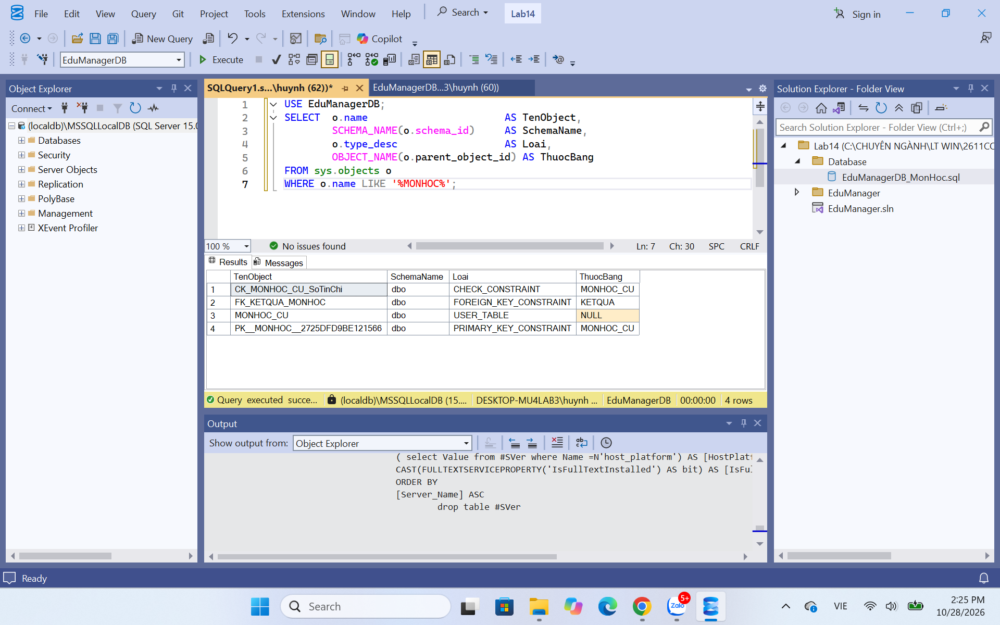

### 2. Cấu hình connection string

Mở **`EduManager/Data/EduManagerContext.cs`**, sửa `Server=` cho đúng SQL Server trên máy:

```csharp
// Mặc định trong project (LocalDB)
@"Server=(localdb)\MSSQLLocalDB;Database=EduManagerDB;Trusted_Connection=True;TrustServerCertificate=True"

// Nếu dùng SQL Express
@"Server=.\SQLEXPRESS;Database=EduManagerDB;Trusted_Connection=True;TrustServerCertificate=True"
```

### 3. Mở và chạy project

1. Mở **`EduManager.sln`** bằng Visual Studio 2022.
2. Visual Studio tự restore NuGet package. Nếu chưa, chuột phải Solution → **Restore NuGet Packages**.
3. **Build → Rebuild Solution**.
4. Nhấn **F5** để chạy.

## 🛡 Xử lý dữ liệu nhập (Validation)

| Ràng buộc | Đặt ở | Thông báo |
|---|---|---|
| Mã môn học không được rỗng | BLL | "Mã môn học không được để trống." |
| Mã tối đa 10 ký tự, không chứa khoảng trắng, tự viết hoa | BLL (+ `MaxLength` ở GUI) | "Mã môn học không được chứa khoảng trắng." |
| Tên môn học không được rỗng, tối đa 100 ký tự, tự bỏ khoảng trắng thừa | BLL | "Tên môn học không được để trống." |
| Số tín chỉ từ 1 đến 6 | BLL (+ `NumericUpDown` 1–6, + CHECK trong DB) | "Số tín chỉ phải nằm trong khoảng từ 1 đến 6." |
| Không cho thêm mã đã tồn tại | BLL (gọi `DAL.Exists`) | "Mã môn học "…" đã tồn tại. Vui lòng nhập mã khác." |
| Xóa phải hỏi xác nhận | GUI (MessageBox Yes/No) | "Bạn có chắc chắn muốn xóa môn học…" |
| Lỗi kết nối / lỗi database | BLL đổi `DbUpdateException`, GUI bắt lỗi chung | Thông báo dễ hiểu, chương trình không bị dừng |

Thứ tự kiểm tra trong BLL: **mã → tên → số tín chỉ → trùng mã**. Dữ liệu sai ở bước nào thì dừng và báo lỗi
bước đó; chỉ khi dữ liệu nhập đã đầy đủ mới truy vấn database để kiểm tra trùng mã.

## 🧪 Test case

| STT | Chức năng | Dữ liệu / Thao tác | Kết quả mong đợi | Kết quả | Minh chứng |
|---|---|---|---|---|---|
| 1 | Load danh sách | Mở Form | Hiển thị danh sách môn học, thanh trạng thái thống kê |  |
| 2 | Thêm hợp lệ | `COMP10026` – Lập trình cơ bản – 3 tín chỉ | |
| 3 | Tên rỗng | `COMP1031`, tên để trống | "Tên môn học không được để trống." | |
| 4 | Thứ tự kiểm tra | `COMP1019` (đã tồn tại), tên để trống | Báo lỗi tên rỗng trước, chưa kiểm tra trùng mã |  |
| 5 | Trùng mã | `COMP1019` – Lập trình winds | "Mã môn học "COMP1019" đã tồn tại…" | |
| 6 | Mã có khoảng trắng | `COMP10 10` – Lập trình PHP | "Mã môn học không được chứa khoảng trắng." |  |
| 7 | Chọn dòng | Click dòng `COMP1001` | Dữ liệu hiện lên ô nhập, mã bị khóa, chuyển chế độ Sửa / Xóa |  |
| 8 | Sửa | `COMP1001`: số tín chỉ 2 → 3 | "Đã cập nhật môn học "COMP1001"." | |
| 9 | Xóa – xác nhận | Chọn `COMP1017` → Xóa | Hiện hộp hỏi xác nhận Yes/No |  |
| 10 | Xóa – đồng ý | Chọn **Yes** | "Đã xóa môn học "COMP1017"." | |
| 11 | Tìm theo mã | Từ khóa `MATH` | Hiện 2 môn: MATH1001, MATH1005 |  |
| 12 | Tìm theo tên | Từ khóa `Lập trình` | Hiện 3 môn có tên chứa "Lập trình" | |
| 13 | Làm mới | Bấm **Làm mới** | Xóa trắng ô nhập, về chế độ Thêm mới, load lại toàn bộ |  |

## ❓ Trả lời câu hỏi

**1. Vì sao không nên viết toàn bộ code CRUD trong sự kiện Button Click?**

Vì khi đó code giao diện, kiểm tra nghiệp vụ và truy cập dữ liệu bị trộn vào một chỗ: khó đọc, khó sửa,
khó kiểm thử. Muốn dùng lại chức năng ở form khác thì phải chép lại code; khi đổi cách lưu trữ (ví dụ từ
ADO.NET sang EF Core) phải sửa trong từng sự kiện. Tách thành GUI – BLL – DAL giúp mỗi phần làm đúng một
việc, dễ bảo trì và mở rộng cho đồ án lớn hơn.

**2. BLL và DAL khác nhau ở điểm nào?**

- **DAL** (Data Access Layer): chỉ lo *đọc/ghi dữ liệu* – truy vấn, thêm, sửa, xóa bằng EF Core; không biết
  quy tắc nghiệp vụ.
- **BLL** (Business Logic Layer): lo *quy tắc nghiệp vụ* – chuẩn hóa dữ liệu, kiểm tra hợp lệ, kiểm tra trùng
  mã, quyết định có gọi DAL hay không, đổi lỗi kỹ thuật thành thông báo cho người dùng.

**3. Entity Framework khác ADO.NET ở điểm nào?**

| ADO.NET | Entity Framework Core |
|---|---|
| Tự viết câu lệnh SQL, dùng `SqlConnection`, `SqlCommand`, `SqlDataReader` | Là ORM: ánh xạ bảng ↔ class, thao tác bằng LINQ, EF tự sinh SQL |
| Phải tự đọc từng cột và gán vào đối tượng | Tự chuyển dữ liệu thành đối tượng `MonHoc` |
| Tự quản lý mở/đóng kết nối và tham số | `DbContext` quản lý kết nối, theo dõi thay đổi, lưu bằng `SaveChanges()` |
| Kiểm soát SQL chi tiết, có thể nhanh hơn | Viết ít code hơn, dễ bảo trì, hỗ trợ Migration |

**4. Trong bài lab này, validation nào nên đặt ở BLL?**

Mã môn học không rỗng (độ dài, không khoảng trắng), tên môn học không rỗng, số tín chỉ từ 1 đến 6, không
cho thêm mã đã tồn tại, môn học cần sửa/xóa phải tồn tại. Riêng việc **hỏi xác nhận khi xóa** là tương tác
với người dùng nên đặt ở GUI; GUI chỉ hỗ trợ thêm (`MaxLength`, `NumericUpDown` 1–6) cho thân thiện.

## 🖼 Hình ảnh màn hình

### 1. Giao diện chính
Mở Form, danh sách được load từ database; bấm *Làm mới* cũng trở về trạng thái này.


### 2. Thêm môn học


### 3. Validation: tên môn học rỗng
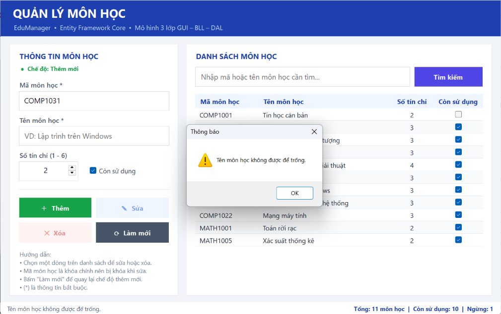

### 4. Thứ tự kiểm tra
Nhập mã đã tồn tại nhưng để trống tên → BLL báo lỗi tên trước khi kiểm tra trùng mã.

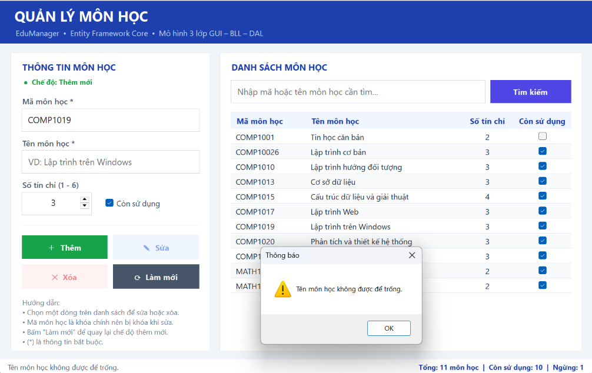

### 5. Validation: trùng mã
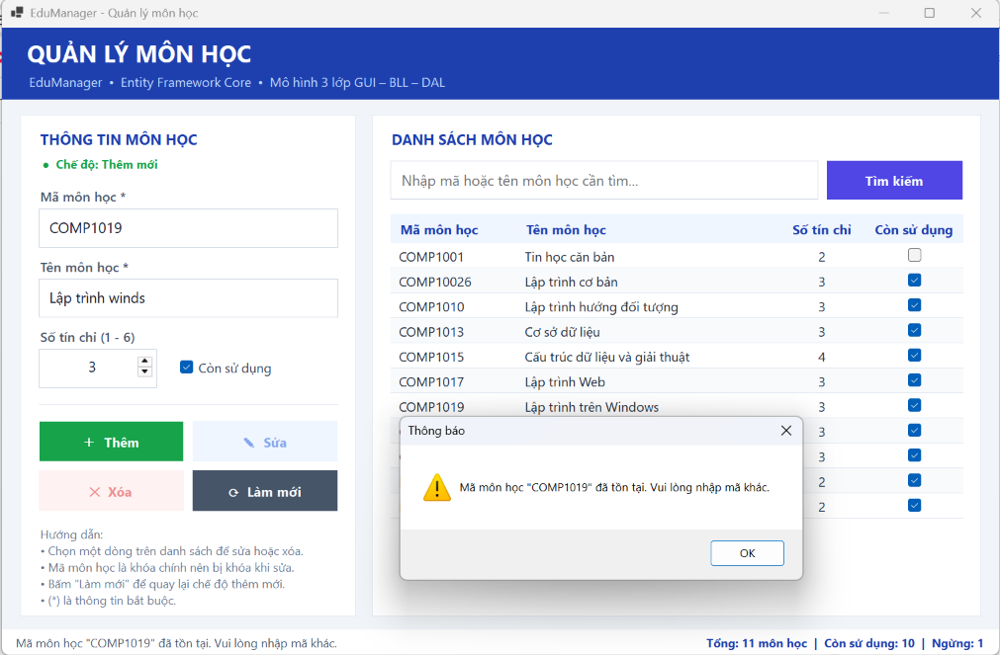

### 6. Validation: mã có khoảng trắng
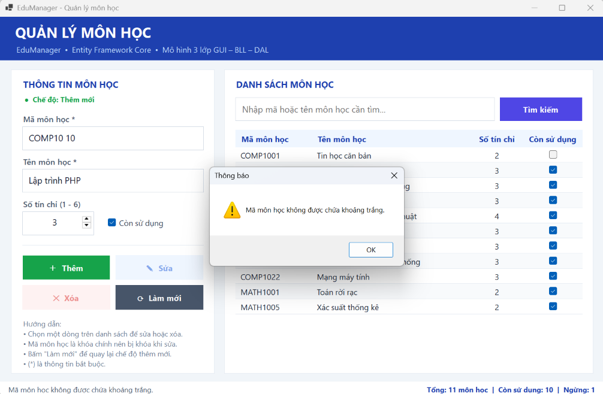

### 7. Chọn dòng trên DataGridView
Dữ liệu hiển thị lại lên ô nhập, ô mã bị khóa, nút Sửa / Xóa được bật.

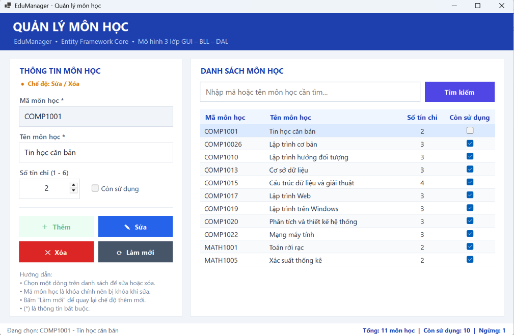

### 8. Sửa môn học
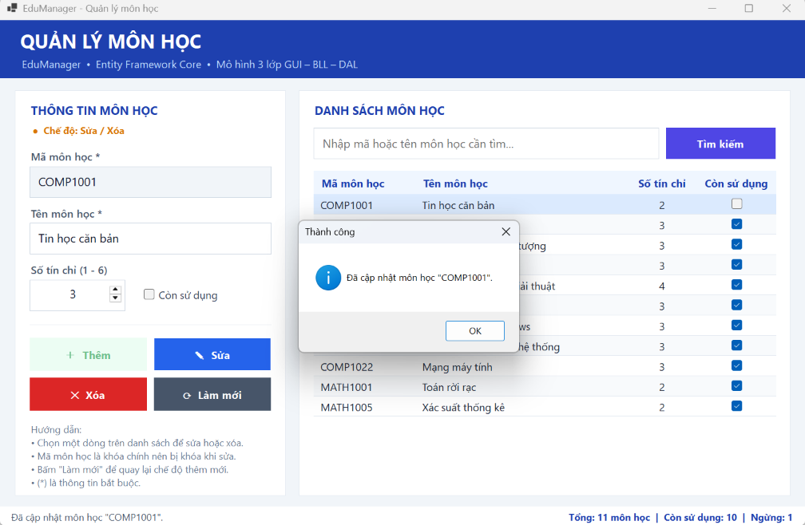

### 9. Xóa môn học
Chọn môn cần xóa:

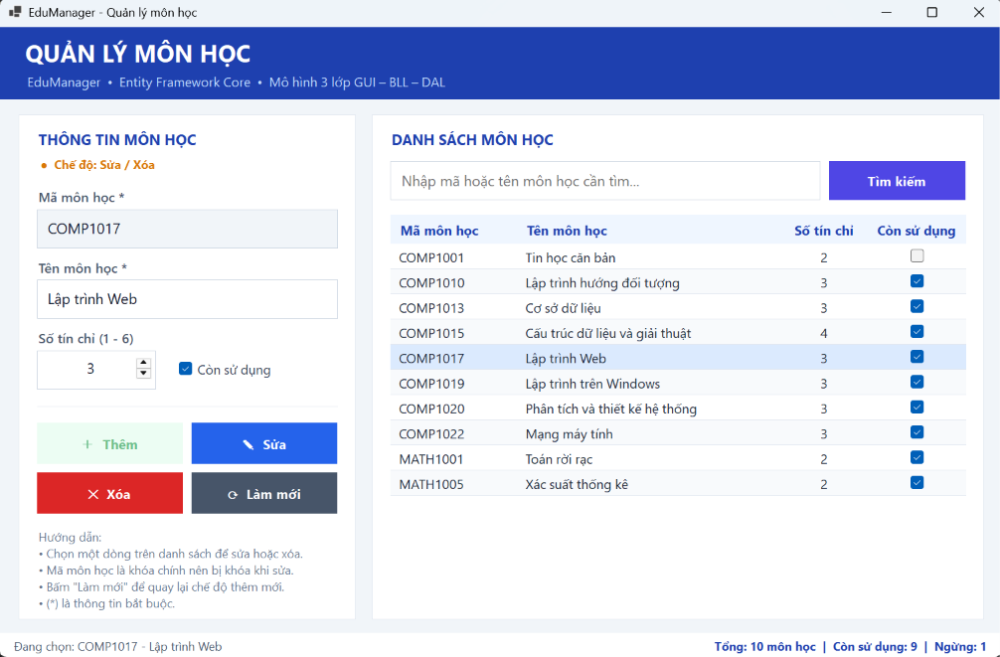

Hỏi xác nhận trước khi xóa:

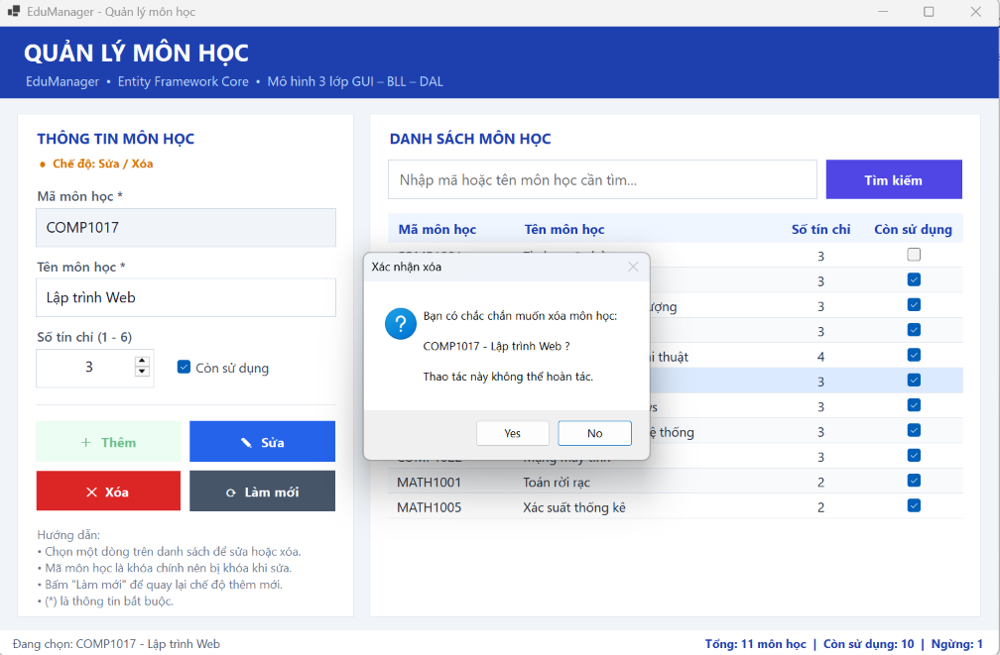

Xóa thành công:

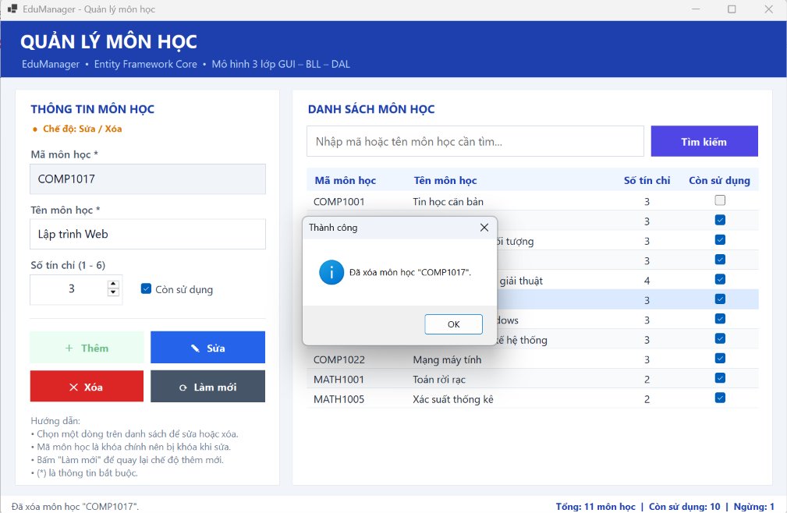

### 10. Tìm kiếm theo mã
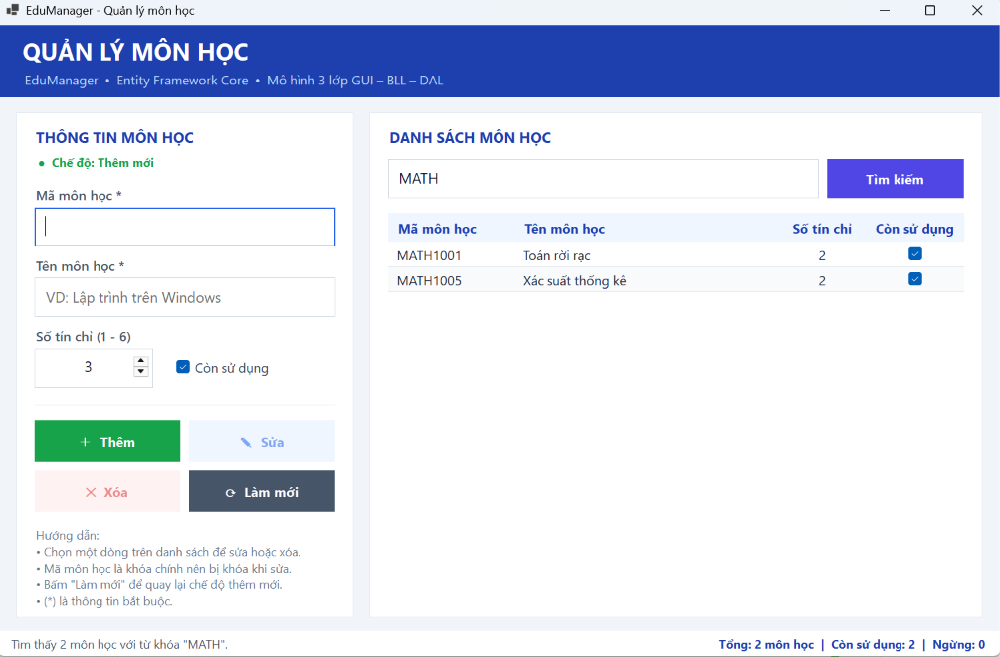

### 11. Tìm kiếm theo tên
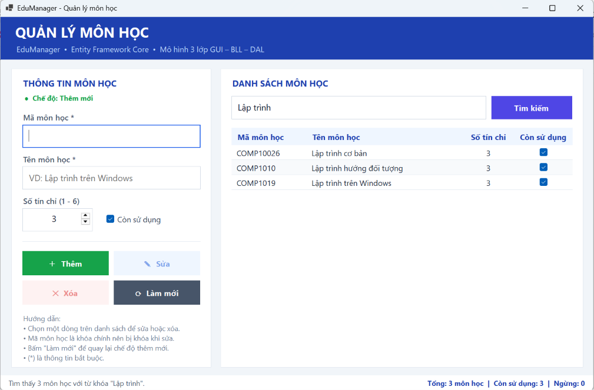
