# Lab 15 – Quản lý sinh viên theo mô hình MVP

## 👩‍🎓 Thông tin sinh viên

| Thông tin | Nội dung |
|---|---|
| Họ và tên | Huỳnh Thị Hồng Ân |
| MSSV | 49.01.103.006 |
| Lớp | 49.01.SPTIN.A |
| Học phần | COMP1019 – Lập trình trên Windows |
| Bài | Lab 15 – MVP, kiểm thử và bàn giao đồ án |

## 📌 Mô tả

**StudentManagerMVP** là ứng dụng C# WinForms quản lý danh sách sinh viên, được tổ chức theo mô hình **MVP (Model – View – Presenter)**:

- **View** (`FrmStudent`) chỉ hiển thị dữ liệu và chuyển sự kiện. Mỗi Button Click chỉ gọi một phương thức của Presenter, ví dụ `_presenter.AddStudent()`.
- **Presenter** (`StudentPresenter`) xử lý toàn bộ nghiệp vụ: Load, Thêm, Xóa, Tìm kiếm và kiểm tra dữ liệu. Presenter làm việc với Form **qua interface `IStudentView`**, không truy cập trực tiếp TextBox hay DataGridView.
- **Repository** (`StudentRepository`) lưu dữ liệu bằng `List<Student>`, có sẵn 8 sinh viên mẫu.

Giao diện được chia thành các khung màu để dễ nhìn:

| Khung | Màu |
|---|---|
| Thông tin sinh viên | Xanh dương nhạt |
| Chức năng | Xanh lá nhạt |
| Tìm kiếm | Vàng nhạt |
| Danh sách sinh viên | Trắng, dòng xen kẽ xanh nhạt; cột Xếp loại tô màu theo mức |

Các nút: **Thêm** (xanh lá), **Xóa theo mã** (đỏ), **Load danh sách** (xanh dương), **Làm mới** (xám), **Tìm kiếm** (cam).

## 🛠 Công nghệ sử dụng

- Ngôn ngữ: C#
- Nền tảng: .NET 8 – Windows Forms
- IDE: Visual Studio 2022 (17.8 trở lên), workload *.NET desktop development*
- Lưu trữ: `List<Student>` trong bộ nhớ

## 🧱 Cấu trúc project

```
Lab15/
|-- StudentManagerMVP.sln
|-- StudentManagerMVP/
|   |-- Models/
|   |   |-- Student.cs
|   |-- Views/
|   |   |-- IStudentView.cs
|   |   |-- FrmStudent.cs
|   |   |-- FrmStudent.Designer.cs
|   |-- Presenters/
|   |   |-- StudentPresenter.cs
|   |-- Repositories/
|   |   |-- IStudentRepository.cs
|   |   |-- StudentRepository.cs
|   |-- Program.cs
|-- screenshots/
|-- TestCases.md
|-- Checklist_BanGiao.md
|-- README.md
|-- README.txt
|-- .gitignore
```

## 📋 Yêu cầu class

| Thành phần | Vai trò |
|---|---|
| `Student` | Mã SV, Họ tên, Lớp, Điểm TB, Xếp loại (Giỏi ≥ 8, Khá ≥ 6.5, Trung bình ≥ 5, Yếu < 5) |
| `IStudentView` | Dữ liệu nhập, `ShowStudents`, `ShowMessage`, `Confirm`, `SetFieldError`, `ClearErrors`, `FocusField`, `ClearInputs` |
| `FrmStudent` | Implements `IStudentView`; các sự kiện chỉ gọi Presenter |
| `StudentPresenter` | `LoadStudents`, `AddStudent`, `DeleteStudent`, `SearchStudents`, `SelectStudent`, `ResetForm` |
| `IStudentRepository` / `StudentRepository` | `GetAll`, `GetById`, `Exists`, `Add`, `Delete`, `Search` |

## ✅ Chức năng

1. **Load danh sách**: hiển thị 8 sinh viên mẫu ngay khi mở Form; nút *Load danh sách* tải lại.
2. **Thêm** sinh viên (Mã SV, Họ tên, Lớp, Điểm TB).
3. **Xóa theo mã**: nhập Mã SV hoặc bấm chọn dòng, có hộp thoại xác nhận Yes/No.
4. **Tìm kiếm** theo mã hoặc một phần họ tên, không phân biệt hoa/thường và dấu; nhấn Enter để tìm.
5. **Làm mới**: xóa trắng ô nhập, ô tìm kiếm và tải lại danh sách.
6. Bấm vào một dòng thì dữ liệu được đưa lên các ô nhập.
7. **Thông báo kết quả** bằng hộp thoại và thanh trạng thái (xanh = thành công, cam = cảnh báo, đỏ = lỗi).

## ▶️ Cách chạy

1. Clone repository hoặc giải nén file nộp ra một thư mục.
2. Mở `StudentManagerMVP.sln` bằng Visual Studio 2022.
3. Chọn **Build → Rebuild Solution**.
4. Nhấn **F5** để chạy. Form hiển thị ngay 8 sinh viên mẫu.

- **Cơ sở dữ liệu:** không sử dụng, không cần phục hồi database. Dữ liệu trở về 8 sinh viên mẫu mỗi lần chạy lại.
- **Tài khoản demo:** không có (ứng dụng không yêu cầu đăng nhập).

## 🔎 Xử lý dữ liệu nhập

| Trường hợp | Cách xử lý |
|---|---|
| Để trống ô bắt buộc | Tô đỏ nhạt các ô trống, hiện biểu tượng lỗi (ErrorProvider) và cảnh báo |
| Mã SV sai định dạng | Chỉ nhận chữ và số, dài 3–10 ký tự; tự chuyển thành chữ in hoa |
| Họ tên có số hoặc ký tự đặc biệt | Báo lỗi "Họ tên chỉ gồm chữ cái và khoảng trắng, dài 2–50 ký tự" |
| Điểm không phải số | Báo lỗi; chấp nhận cả `7.5` và `7,5` |
| Điểm ngoài 0–10 | Báo lỗi "Điểm phải nằm trong khoảng 0 đến 10" |
| Mã SV đã tồn tại | Báo lỗi trùng mã, không thêm |
| Xóa mã không tồn tại | Báo "Không tìm thấy sinh viên có mã ..." |
| Tìm kiếm không có kết quả | Bảng trống và cảnh báo không tìm thấy |

## 🧪 Kết quả kiểm thử

| ID | Chức năng | Dữ liệu thử | Kết quả | Đạt |
|---|---|---|---|---|
| TC01 | Load danh sách | Mở Form | Hiển thị 8 sinh viên, "Tổng: 8 sinh viên" | ✔ |
| TC02 | Thêm hợp lệ | `SV009` / Trần Văn Nam / 49.01.SPTIN.A / 8.9 | "Đã thêm sinh viên SV009 - Trần Văn Nam thành công", tổng 9 sinh viên | ✔ |
| TC03 | Dữ liệu rỗng | Chỉ nhập Mã SV `SV001`, bỏ trống Họ tên, Lớp, Điểm | Cảnh báo "Vui lòng nhập đầy đủ...", 3 ô trống tô đỏ | ✔ |
| TC04 | Trùng mã | `SV001` / Lê Thi Nhí / 48.01.CNNT.A / 7.5 | Lỗi "Mã SV "SV001" đã tồn tại", không thêm | ✔ |
| TC05 | Xóa – xác nhận | Chọn dòng `SV005` → Xóa theo mã | Hiện hộp "Bạn có chắc muốn xóa sinh viên SV005 - Võ Minh Đức?" | ✔ |
| TC06 | Xóa thành công | Chọn **Yes** | "Đã xóa sinh viên SV005 - Võ Minh Đức", tổng còn 8 sinh viên | ✔ |
| TC07 | Tìm kiếm theo tên | `Huỳnh Thị Hồng Ân` | Tìm thấy 1 sinh viên: SV006 | ✔ |
| TC08 | Điểm ngoài khoảng | Điểm `11` | Lỗi "Điểm phải nằm trong khoảng 0 đến 10" | ✔ |
| TC09 | Họ tên sai kiểu | Họ tên `Trần Văn Nam123` | Lỗi "Họ tên chỉ gồm chữ cái và khoảng trắng, dài 2–50 ký tự" | ✔ |
| TC10 | Tìm mã không tồn tại | `SV999` | Bảng trống, cảnh báo "Không tìm thấy sinh viên nào khớp với "SV999"" | ✔ |
| TC11 | Tìm từ khóa không có | `XZY` | Bảng trống, cảnh báo "Không tìm thấy sinh viên nào khớp với "XZY"" | ✔ |

Chi tiết xem thêm trong [`TestCases.md`](TestCases.md) và [`Checklist_BanGiao.md`](Checklist_BanGiao.md).

## 🖼 Hình ảnh màn hình

### 1. Màn hình chính – Load danh sách
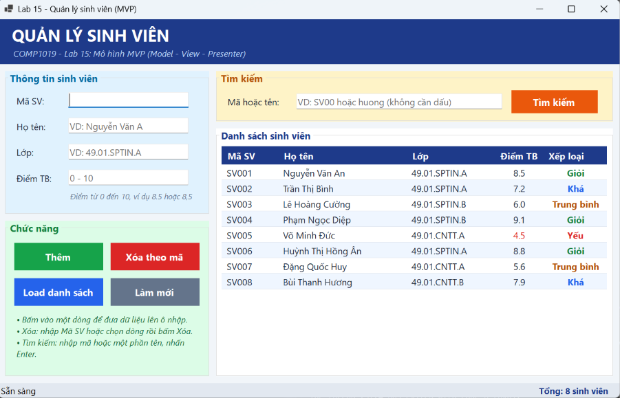

### 2. Thêm sinh viên thành công
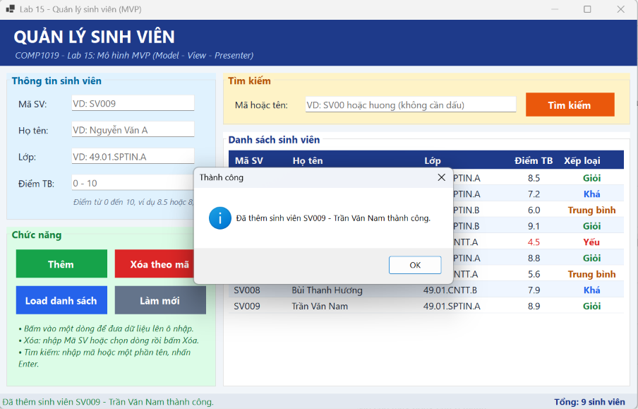

### 3. Kiểm tra dữ liệu rỗng
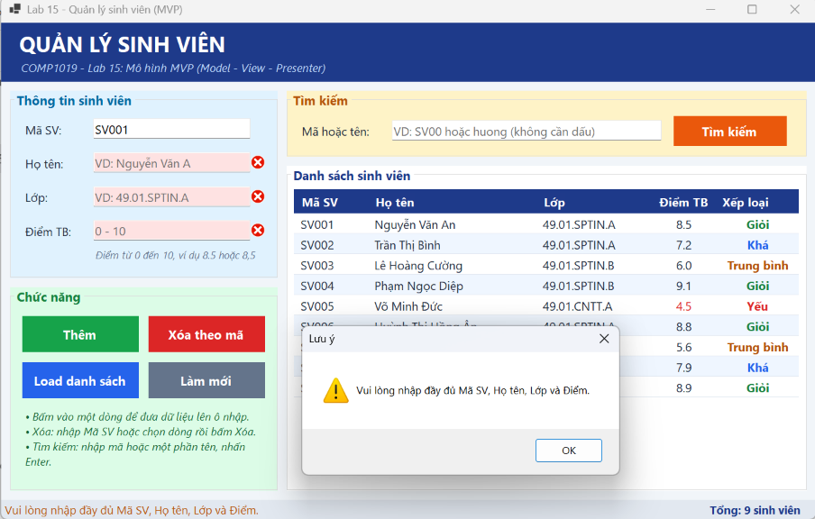

### 4. Báo lỗi trùng mã
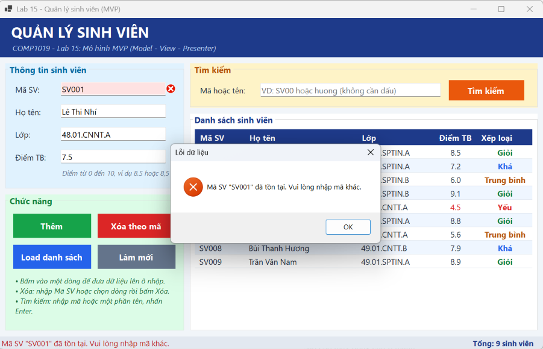

### 5. Xác nhận trước khi xóa
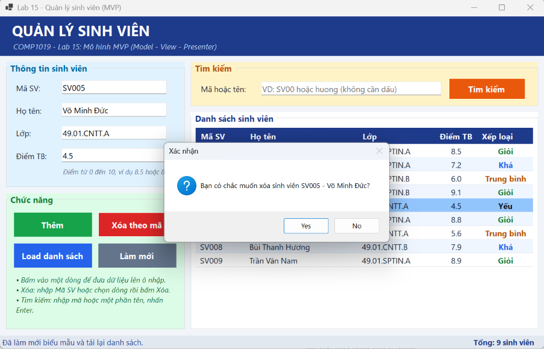

### 6. Xóa sinh viên thành công
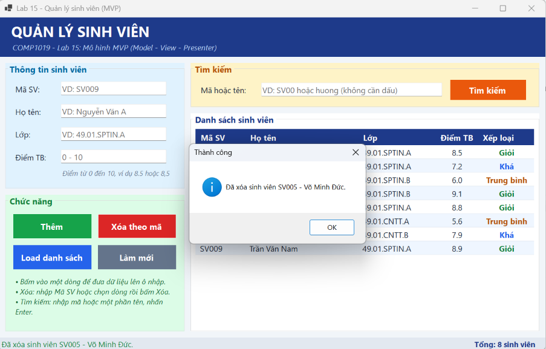

### 7. Tìm kiếm theo họ tên
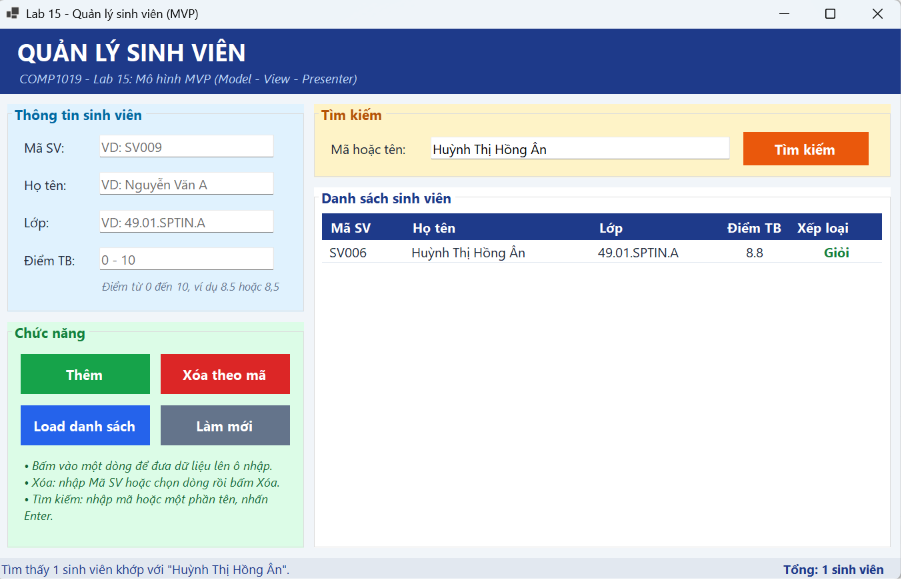

### 8. Điểm ngoài khoảng 0–10
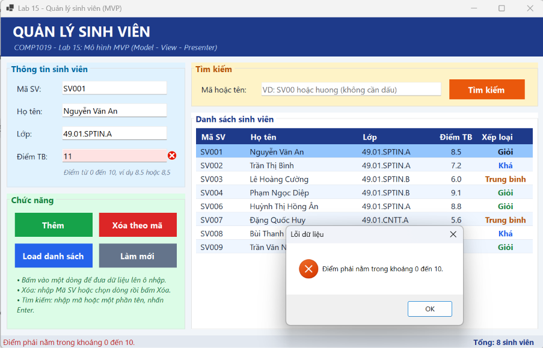

### 9. Họ tên sai kiểu
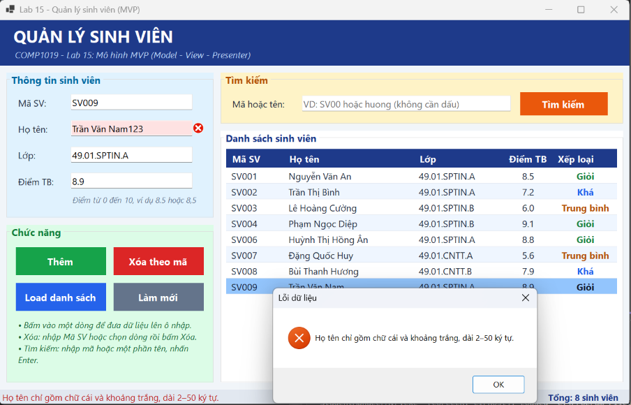

### 10. Tìm mã không tồn tại
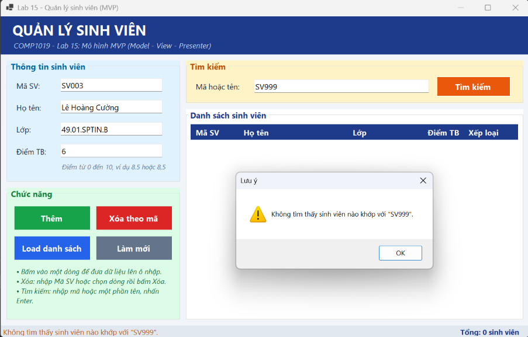

### 11. Tìm từ khóa không có kết quả
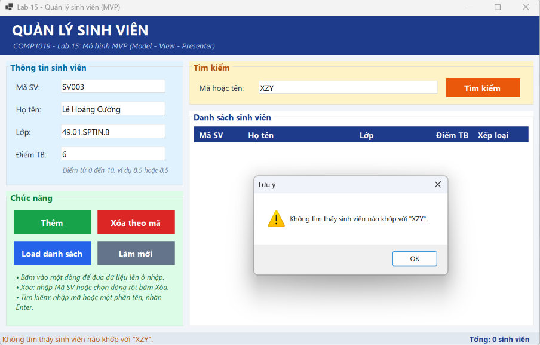
